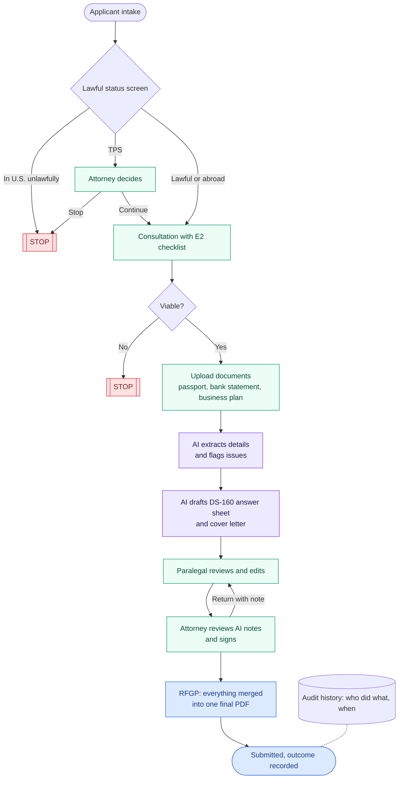

# Agent RFGP Generator

An agentic workflow for E2 visa cases, built by Kwanso. An applicant's case is opened, AI checks the documents and drafts the paperwork, and the system merges everything into one final RFGP (final submission) PDF. People approve every step.

The same workflow can be set up for any document-heavy process: collecting documents, checking them with AI, filling forms and producing one final file.

## Workflow



Purple steps are done by AI, green steps by people, and every AI output is a draft that a person approves.

| Step | In the app | Who acts |
|---|---|---|
| Identify applicant | Intake form (`/cases/new`) | Paralegal |
| Lawful status screen | Automatic: unlawful → **STOP**, TPS → attorney flag | System |
| Consultation | Digital E2 checklist | Attorney |
| Viability decision | Viable, or Not viable → **STOP** | Attorney |
| Packet creation | Upload documents; **AI extracts** passport, bank statement and business plan data and flags issues | Paralegal |
| Paralegal review | **AI drafts** a DS-160 answer sheet and cover letter; paralegal edits and approves | Paralegal |
| Attorney review | AI review notes, merged RFGP PDF, sign or return | Attorney |
| Submitted | Interview date and outcome | Paralegal |

Use the **Acting as** dropdown (top right) to switch between Paralegal, Attorney and Applicant. Steps owned by another role are locked.

## Run it

```bash
npm install
cp .env.example .env.local   # then add your ANTHROPIC_API_KEY
npm run setup                # creates the SQLite database, seeds 3 demo cases, writes sample PDFs
npm run dev
```

Open http://localhost:3000. Run `npm run seed` to reset the demo data.

## Demo walkthrough

1. The board shows each workflow step as a column, plus the stopped cases (Lukas, unlawful status) and the TPS attorney flag (Ana).
2. **+ Identify potential applicant**: Maria Elena Gonzalez Ruiz, Spain, outside the U.S., Sol Coffee Roasters LLC, $150,000.
3. Switch to **Attorney**, tick the checklist, click **Viable**.
4. Switch to **Paralegal** and upload the three files from `samples/`. The AI reads each one and flags issues such as an unexplained cash deposit.
5. **Draft packet**: the AI writes the DS-160 answer sheet and cover letter; sections appear live. Fields it can't know are marked NEEDS APPLICANT.
6. Edit a field, then **Approve → send to attorney**.
7. Switch to **Attorney**: review the flags, open the RFGP PDF, sign.
8. Record the interview date and outcome.

## Notes

- Demo data only. `samples/` holds fictional specimen documents. There is no login yet and uploads are stored unencrypted in `uploads/`, so don't use real documents.
- `DEMO_MODE` (default on) tells the AI the samples are fictional, so it doesn't flag the SPECIMEN watermark. Set `DEMO_MODE=false` in `.env.local` for real-looking documents.
- AI runs on `claude-opus-5-5` through `@anthropic-ai/sdk` with structured outputs (`src/lib/ai.ts`).
- The DS-160 is filed on ceac.state.gov, which has no API, so the app produces an answer sheet and submits nothing.
- The checklist in `src/lib/workflow.ts` is a sample of common E2 requirements.
- `docs/` holds the production database design.
