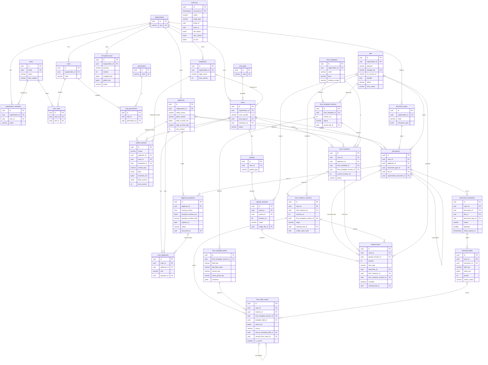

# E2 Visa Case Workflow: Phase 1 Database Design (final, after review)

*Stack: PostgreSQL 16+, NestJS, TypeORM (migrations only, `synchronize: false`), file bytes in a versioned S3 bucket. Audience: the Kwanso engineers who will write the entities and migrations.*

## Summary

**Phase 1 has 30 tables.** Section 6 lists about 45 more for later features. Each of them can be added as a new table, a new row or a nullable column, without changing what any existing column means.

The decisions that matter most, in plain language:

1. **Work is organised around a "case": one visa filing.** People are linked to a case with a role. Phase 1 uses only the principal; spouse and children come later. One person can have many cases over the years. Phase 1 creates the case automatically, so staff only ever see "applicant".
2. **The long DS-160-style questionnaire is stored one section at a time**, as one flexible record per section. The list of questions lives in code. Going from "name, email, DOB" to hundreds of questions needs no database change.
3. **Passports and businesses are records in their own right.** A person can hold several passports (dual nationals, renewals), and each filing records which passport it used. A business is shared by every filing that relies on it: renewals, co-investors and employees.
4. **Nothing is overwritten.** Every AI reading, form value, form save point and RFGP version is a new row. Future attorney approvals and signatures will point at an exact saved version and the exact PDF that was produced from it.
5. **Sensitive data is encrypted inside the database.** This covers date of birth, passport and ID numbers, every form value, every AI-extracted value, and the personal data inside the audit log. Exact-match search on DOB and passport number still works through "blind indexes".
6. **There is one audit log, and the database writes it itself.** It records every change with before and after values. Separate events record downloads, reveals of sensitive data, AI runs and RFGP generation. Nobody can edit the log, the application included.
7. **Roles and permissions are data.** Phase 1 has one "admin" role holding every permission. Paralegal, attorney and applicant roles are added later as rows.
8. **Every future feature on the list is additive.** Workflow stages, approvals, tasks, comments, notifications, outcomes, the applicant portal, EB-5, imports, integrations and outside firms all fit in without reshaping these 30 tables.

**Where this design comes from.** It started from Design A with grafts from Designs B and C. An adversarial review then raised 48 findings. 47 were accepted in full or in part and 1 was rejected; appendix-style one-liners are in the review resolution. The main changes from the review:
- Three tables were added: `enterprises`, `applicant_passports` and `organization_members` (27 → 30).
- `case_id` is now on every row that belongs to a case, child rows included. One generic trigger checks every child row against its parent.
- Form values and AI-extracted values are always encrypted. There is no TypeORM ValueTransformer, and every ciphertext is bound to its row.
- The audit log keeps the history of sensitive values as ciphertext and encrypts personal data inside the trigger. No plaintext PII reaches the log.
- The rendered PDF is part of what a revision pins. It must exist before a form is finalised and before an RFGP is queued.
- Document replacement now works by the new document naming the old one, so the old row is never updated. Allowed status changes are enforced in the database. Workers hold leases. S3 uploads are checksum-verified and every read names an exact S3 object version.
- Profile sections are created when first saved. Every get-or-create uses `ON CONFLICT`. Every request runs inside a transaction.

---

## 1. Design principles

### 1.1 Principles

1. **The rule behind every choice.** Some Postgres changes are cheap and safe: adding a table, a row, a nullable column or an index, or adding an allowed value to a CHECK. Others are expensive:
   - changing what a row means (its grain)
   - moving a foreign key to a different parent
   - turning JSON into rows, or rows into JSON
   - encrypting data that was stored as plaintext, especially in append-only tables
   - adding `organization_id` or `case_id` to child tables once data exists

   Phase 1 therefore gets grain, parents, tenancy and case columns, and encryption right now.
2. **A case (one filing) exists from day one.** Documents, form instances and packets belong to a `cases` row. People are linked to a case through `case_applicants`, with a role. Phase 1 writes one `principal` row; dependents later are more rows. A business is an `enterprises` row, and every case that relies on it references it through `cases.enterprise_id`.
3. **People, logins and memberships are three separate tables:**
   - `applicants`: the people we hold data about
   - `users`: login accounts
   - `organization_members`: which organisations a user belongs to

   There are no per-role person tables and no polymorphic person ids. `users` is global. A user belongs to an organisation through `organization_members` and holds roles there through `user_roles`.
4. **Each catalog section is stored in exactly one place:**
   - `core` → typed columns on `applicants` (names, email, phone, DOB, citizenship)
   - `passport` → rows in `applicant_passports`, because a person can hold several
   - every other section → one JSONB row in `profile_sections` per owner. Each row has one of four scopes: `applicant`, `applicant_case`, `case` or `enterprise`.

   The field catalog (keys, types, zod validation, labels, sensitivity, scope, storage) lives in a shared TypeScript package. Sections are created on first save, so adding a question or a whole section is a code change, not a migration.
5. **Sensitive values live only in `*_enc bytea` columns.** They use AES-256-GCM with KMS-wrapped data keys. The AAD (additional authenticated data) binds each ciphertext to its table, column, row and organisation. Two rules apply:
   - **Every form value and every AI-extracted value is always encrypted.** Getting a sensitivity flag wrong can no longer leak plaintext.
   - **In the profile, only sensitive leaves go to `sensitive_enc`.** Everything else stays in plaintext `data`, so profile data stays readable and diffable by key.

   JSONB never holds ciphertext. Exact-match search on DOB and passport number uses HMAC blind indexes tagged with their key version.
6. **Outputs are written once and never changed.** This covers AI extraction runs, extracted values, form field values, form revisions and their rendered PDFs, generated packets and file bytes. A human edit adds a new row. Triggers enforce this, including which status transitions are allowed; it is not left to convention.
7. **Anything a later approval or pin must point at is a row with an id:**
   - `documents`: the file never changes. A replacement is a new row that names the document it supersedes.
   - `form_instance_revisions`: including its rendered PDF, which is fixed once it has been produced.
   - `packet_versions`

   A re-upload or an edit can therefore never wipe an approval.
8. **One `files` table for every S3 object.** Bucket versioning is on, and every read uses the stored S3 version id. Any code that writes an S3 object follows three steps:
   1. commit a `pending` `files` row
   2. upload the bytes
   3. mark the row `ready` inside the business transaction

   A sweeper deletes leftovers, so no S3 object is ever untracked.
9. **No generic `jobs` table in Phase 1.** Two jobs run in the background: AI extraction and the RFGP merge. Each keeps its status on the row it produces. pg-boss runs on the same Postgres database, and jobs are sent on the business transaction's own connection. A lease plus an attempt counter makes a duplicate worker harmless. Prefill, PDF parsing and rendering run synchronously.
10. **Things that grow are lookup tables** with a uuid primary key and a unique `code`: `visa_types`, `document_types`, `form_templates`, `permissions`, `roles`. Small state sets owned by the code are `varchar` columns with a CHECK, mirrored by a TypeScript union. Postgres enum types are never used.
11. **Audit is one append-only table (`audit_log`), written from two central places:**
    - **A generic trigger records every row change**, with before and after values. Personal-data columns never appear in plaintext: the trigger encrypts their values into `pii_enc` with the organisation's audit public key. `*_enc` values are copied as ciphertext, so earlier sensitive values can still be recovered, and crypto-shredding still erases them.
    - **`AuditService.record()` writes domain events**: downloads, reveals of sensitive data, AI runs, prefill, render, generate and login.

    An application write with no actor context fails. No individual call site writes change history.
12. **`organization_id` is on every tenant-owned row, and `case_id` on every row that belongs to a case, child rows included.** Both are frozen after insert and checked against the parent row by one generic trigger. Row-level security later, whether per organisation or per case, then needs only policies.
13. **Business records are soft-deleted**, and every unique index on a soft-deletable table is partial. History rows are never deleted. Roles and grant rows are hard-deleted; the audit trigger keeps a copy of the deleted row.
14. **Optimistic locking uses compare-and-set.** The service runs `UPDATE … WHERE id = $1 AND lock_version = $2` and returns 409 when no row is updated.
15. **Conflicts are computed when they are read, never stored.**
16. **Some future CHECK values are allowed now**, where they are certain to come: `import`, `portal_upload`, `integration`, `spouse`, `child`, `ai`, `purged`.
17. **Every request runs inside a transaction, reads included** (READ ONLY for GET). The audit and security context is therefore always set.
18. **Get-or-create is always `INSERT … ON CONFLICT DO NOTHING`, then `SELECT`.** Never catch a unique violation inside a transaction: Postgres aborts the whole transaction when one occurs.

### 1.2 Key decisions

| # | Question | Decision |
|---|---|---|
| a | Should Phase 1 have a filing/case entity? | **Yes.** `cases` plus `case_applicants`. The UI creates both silently with each new applicant and can hide the case until a second filing or dependents exist (Q2). |
| b | How is the long applicant profile stored? | **Three places, chosen per section:** typed `core` columns on `applicants`, `applicant_passports` rows, and one JSONB row per section in `profile_sections` with the catalog kept in code. Sensitive leaves go in `sensitive_enc`; provenance goes in `field_sources`. The alternatives were rejected. Wide typed columns need a migration per question. An EAV field/value store means four tables and a home-made rules interpreter. One blob per applicant loses concurrent edits. |
| c | How are forms modelled? | `form_templates` holds the form, with `kind` = `question_set` (DS-160) or `pdf_acroform`. `form_template_versions` holds an edition, whose structure freezes when published. `form_template_fields` holds a field or question plus its mapping. `form_instances` is one form for one case (and one applicant, for per-applicant forms). `form_instance_revisions` is an immutable save point; its rendered PDF is set once and is part of the pin. `form_field_values` holds append-only, always-encrypted values. |
| d | How do AI extractions feed the profile and prefill? | Each run is a `document_extractions` row and each value an `extracted_fields` row, keyed by a catalog `field_key`. Values never reach the profile automatically: staff accept or reject them (Q4). Prefill order is profile, then extraction (by the priority recorded with the value, then confidence), then template default, then blank. |
| e | How is the RFGP packet modelled? | `packets` is created explicitly, and a case can have several. It has many `packet_versions`. A `draft` version is the builder. Generate renders and pins every item, then freezes the version. Editing afterwards copies the builder columns into a new draft. `packet_items` is the ordered list, with include/skip plus a reason. |
| f | One files table, or file columns on each table? | **One `files` table.** The S3 version id is recorded, and the SHA-256 is verified by S3 at upload. |
| g | How is background job status tracked? | **On the row the job produces**, with `lease_expires_at` and `attempts` as a fencing token. pg-boss is the transport. |
| h | Passports? | **Their own table, `applicant_passports`.** `case_applicants.passport_id` records the passport, and so the treaty nationality, used for each filing. |
| i | Businesses? | **Their own table, `enterprises`, shared across cases** through `cases.enterprise_id`. Company facts go in an `enterprise`-scope section. Investor-specific facts go in a `case`-scope section. |
| j | Personal data in the audit log? | **Never in plaintext.** PII column values are encrypted inside the trigger (`pii_enc`), and `*_enc` values are stored as ciphertext. A `privacy_admin` database role can redact both for an erasure request. |
| k | Parent/child consistency (same case, same organisation, revision belongs to its form)? | **One generic `assert_parent()` trigger**, not composite FKs. Parent keys are frozen, so an insert-time check gives the same guarantee. It also avoids TypeORM's fragile multi-column join columns that share `case_id` or `organization_id`. |

### 1.3 Conventions (they apply to every table below)

- **Primary key:** `id uuid PK DEFAULT gen_random_uuid()` on every table, lookups and join tables included.
  - The app generates every id with `crypto.randomUUID()` before insert. The AAD of encrypted columns includes the row id, and deterministic ids become possible later.
  - The database default is only a fallback for raw SQL.
  - The audit log's `entity_id` is therefore always a uuid.
- **Timestamps:**
  - `created_at timestamptz NOT NULL DEFAULT now()` on every table.
  - `updated_at timestamptz NOT NULL DEFAULT now()` on every mutable table.
- **Soft delete:** `deleted_at timestamptz NULL` where the table notes say "soft delete".
- **Actor columns:** `created_by` and `updated_by` are `uuid NULL` FKs to `users`. NULL means the system did it.
- **Tenancy:** `organization_id uuid NOT NULL` FK `organizations` on every tenant-owned table. The only tables without it are `organizations`, `users`, `permissions`, `visa_types`, `role_permissions` and `user_roles`; the last two take their organisation from `roles`.
- **Case scoping:** `case_id uuid NOT NULL` FK `cases` on every row that belongs to one case: `case_applicants`, `documents`, `document_extractions`, `extracted_fields`, `form_instances`, `form_instance_revisions`, `form_field_values`, `packets`, `packet_versions` and `packet_items`. It is frozen after insert and checked against the parent row (9.6).
- **Foreign keys:** `ON DELETE RESTRICT` unless noted otherwise.
- **Status and kind columns:** lowercase snake_case values, `varchar` plus a named CHECK (`ck_<table>_<col>`). Allowed transitions are enforced by trigger (9.6).
- **Encrypted columns:**
  - `*_enc bytea` holds an envelope: `version (1 byte)`, `encryption_key_id (16 bytes)`, `nonce (12 bytes)`, `ciphertext`, `tag (16 bytes)`.
  - AAD = `'<table>.<column>:<row id>:<organization_id>'`.
- **Blind-index columns:** `*_bidx varchar(80)` holds `'v<key version>:' || hex(HMAC-SHA256(blind_index key, '<column>:' || normalized value))`. A search computes the value under every blind-index key that has not been destroyed.
- **Optimistic lock:** `lock_version int NOT NULL DEFAULT 1` (`@VersionColumn`).
- **Extensions:**
  - `citext`
  - `pgcrypto`, used by the audit trigger for `pgp_pub_encrypt`
  - `gen_random_uuid()` is built into PostgreSQL 13 and later.

### 1.4 The field catalog (code, not the database)

The catalog is a shared TypeScript package used by the API, the workers and the frontend.

**Each section defines:**
- its key and scope (`applicant`, `applicant_case`, `case` or `enterprise`)
- its storage: `applicant_core`, `passport` or `profile`
- its zod schema and its `schema_version`
- for each field: label, type, whether it is `sensitive`, and (later) whether the portal may edit it

**Key format.**
- A key is `<section>.<field>`, for example `personal.place_of_birth` or `e2_investment.amount_invested`.
- Section keys are unique, so field keys are unique.
- Repeating groups (previous visits, employers) are `list` fields whose items each carry a stable `_id` uuid. Paths to items look like `us_history.previous_visits[<_id>].arrival_date`.

**Sections:**
- **`applicant` scope:**
  - `core` (stored on `applicants`): names, email, phone, `date_of_birth`, `citizenship_country`
  - `passport` (stored in `applicant_passports`; a list): number, issuing country, dates, status, type, issuing city and authority, book number
  - `personal`, `ids` (sensitive), `contact`, `family`, `work_education`, `us_history` (stored in `profile_sections`)
- **`applicant_case` scope:**
  - `travel`: purpose, arrival, length of stay, U.S. address, payer, companions
  - `security`: answers attested for this filing
- **`case` scope:**
  - `e2_investment`: ownership percentage, amount invested, source of funds, the investor's role
  - `us_contact`
- **`enterprise` scope:**
  - `e2_enterprise`: EIN, address, date established, business activity, employees, financials. The legal name is the typed column `enterprises.legal_name`.

**Passport resolution.** `passport.*` keys resolve to the passport chosen for the filing (`case_applicants.passport_id`). If none is chosen, they fall back to the person's single `valid` passport. If there are several valid passports and none is chosen, the field is left blank and flagged `multiple_values`.

**Integrity rules, checked in CI and at app startup:**
- Every stored `form_template_fields.source_key` and every `document_types.extraction_spec` field key must exist in the catalog.
- Keys are never renamed or re-typed. They are deprecated, and a new key is added.
- **Service invariant:** every save updates `field_sources[path]` for every path that changed, sensitive paths included. The audit diff of `field_sources` then names the exact leaf that changed, even inside `sensitive_enc`.

---

## 2. Tables

| Area | Tables | Count |
|---|---|---|
| 2.1 Organization and access | organizations, users, organization_members, roles, permissions, role_permissions, user_roles | 7 |
| 2.2 Reference | visa_types, document_types | 2 |
| 2.3 People, businesses and cases | applicants, applicant_passports, enterprises, cases, case_applicants, profile_sections | 6 |
| 2.4 Files, documents, extraction | files, documents, document_extractions, extracted_fields | 4 |
| 2.5 Forms | form_templates, form_template_versions, form_template_fields, form_instances, form_instance_revisions, form_field_values | 6 |
| 2.6 RFGP packets | packets, packet_versions, packet_items | 3 |
| 2.7 Platform | audit_log, encryption_keys | 2 |
| **Total** | | **30** |

### 2.1 Organization and access

#### `organizations`
Purpose: the tenant root. There is exactly one row in Phase 1.

| column | type | null? | notes |
|---|---|---|---|
| id | uuid | no | PK |
| name | varchar(200) | no | |
| slug | varchar(60) | no | unique |
| status | varchar(20) | no | CHECK in (`active`,`suspended`); default `active` |
| settings | jsonb | no | default `'{}'`. Non-PII configuration only: `case_number_prefix`, `timezone`, `default_visa_type_code` |
| created_at, updated_at | timestamptz | no | |

Indexes: `uq_organizations_slug (slug)`.

#### `users`
Purpose: a login account. It is global, not tied to one organisation. Phase 1 has staff only; applicant-portal and outside-firm users are added later as rows.

| column | type | null? | notes |
|---|---|---|---|
| id | uuid | no | PK |
| email | citext | no | login email |
| full_name | varchar(200) | no | |
| status | varchar(20) | no | CHECK in (`active`,`disabled`); default `active`. **Platform level only:** a disabled user cannot log in anywhere. State within an organisation is on `organization_members` |
| auth_provider | varchar(30) | no | e.g. `cognito`, `google`, `microsoft` (D4) |
| auth_subject | varchar(255) | yes | identity-provider subject id, set at first login |
| last_login_at | timestamptz | yes | |
| created_by | uuid | yes | FK users |
| created_at, updated_at | timestamptz | no | |
| deleted_at | timestamptz | yes | soft delete |

Indexes:
- `uq_users_email (email) WHERE deleted_at IS NULL`
- `uq_users_auth (auth_provider, auth_subject) WHERE auth_subject IS NOT NULL AND deleted_at IS NULL`

Re-inviting someone whose user row was soft-deleted restores that row (clears `deleted_at`) rather than inserting a new one. There is no password column. If local login is ever chosen, it goes in a deferred `user_credentials` table, so password hashes never load with the User entity.

#### `organization_members`
Purpose: a user's membership of one organisation, with its own status and invitation. Phase 1 has one row per staff user. Later, portal users and outside-firm users get rows in their own organisations.

| column | type | null? | notes |
|---|---|---|---|
| id | uuid | no | PK |
| organization_id | uuid | no | FK organizations |
| user_id | uuid | no | FK users |
| status | varchar(20) | no | CHECK in (`invited`,`active`,`disabled`); default `invited`. Transitions: invited→active, invited→disabled, active→disabled, disabled→active |
| invited_by | uuid | yes | FK users |
| joined_at | timestamptz | yes | set at the first login after the invitation |
| created_at, updated_at | timestamptz | no | |
| deleted_at | timestamptz | yes | soft delete |

Indexes:
- `uq_organization_members (organization_id, user_id) WHERE deleted_at IS NULL`
- `ix_organization_members_user (user_id)`

Rules:
- Guards require an `active` membership in `app.organization_id`, plus the permission through `user_roles` → `roles` of that organisation.
- `user.manage` may change memberships and role grants **in its own organisation only**. It never changes global `users` columns.
- Granting a role requires a membership in the role's organisation (service rule).

#### `roles`
Purpose: a named set of permissions within an organisation. Phase 1 seeds one role, `admin`, with every permission, and every staff user is given it.

| column | type | null? | notes |
|---|---|---|---|
| id | uuid | no | PK |
| organization_id | uuid | no | FK organizations |
| code | varchar(50) | no | `admin`; later `paralegal`, `attorney`, `applicant` |
| name | varchar(100) | no | |
| description | text | yes | |
| is_system | boolean | no | default false. System roles cannot be deleted or renamed in the UI |
| created_at, updated_at | timestamptz | no | |

Indexes: `uq_roles_org_code (organization_id, code)`.

Roles are **not** soft-deleted. A role is hard-deleted only when nobody holds it (FK RESTRICT from `user_roles`); its `role_permissions` rows cascade, and the audit trigger keeps the deleted rows.

#### `permissions`
Purpose: the global list of permission codes that NestJS guards check. Rows are added by migrations only.

| column | type | null? | notes |
|---|---|---|---|
| id | uuid | no | PK |
| code | varchar(100) | no | unique, in the form `resource.action` |
| category | varchar(50) | no | grouping for the admin UI |
| description | varchar(300) | no | |
| is_deprecated | boolean | no | default false. Permissions are deprecated, never deleted |
| created_at | timestamptz | no | |

Phase 1 seed:
- `applicant.read`, `applicant.write`
- `case.read`, `case.write` (cases, case-scope and enterprise sections)
- `pii.reveal`
- `document.read`, `document.upload`, `document.delete`
- `extraction.run`, `extraction.review`
- `form_template.manage`
- `form.fill`, `form.finalize`
- `packet.build`, `packet.generate`
- `file.download`
- `audit.read`
- `user.manage`, `role.manage`

Rule: any migration that adds a permission also grants it to every `admin` role in the same migration.

#### `role_permissions`
Purpose: grants a permission to a role.

| column | type | null? | notes |
|---|---|---|---|
| id | uuid | no | PK. A surrogate key, so audit rows have a uuid `entity_id` |
| role_id | uuid | no | FK roles `ON DELETE CASCADE` |
| permission_id | uuid | no | FK permissions |
| created_by | uuid | yes | FK users |
| created_at | timestamptz | no | |

Indexes: `uq_role_permissions (role_id, permission_id)`. Rows are hard-deleted, and the audit trigger keeps the deleted row.

#### `user_roles`
Purpose: grants a role to a user.

| column | type | null? | notes |
|---|---|---|---|
| id | uuid | no | PK |
| user_id | uuid | no | FK users |
| role_id | uuid | no | FK roles (RESTRICT) |
| granted_by | uuid | yes | FK users |
| created_at | timestamptz | no | |

Indexes: `uq_user_roles (user_id, role_id)`; `ix_user_roles_role (role_id)`. Rows are hard-deleted and the deletion is audited.

### 2.2 Reference data

#### `visa_types`
Purpose: global legal reference data. Changes come only through migrations. Phase 1 seeds `E2`.

| column | type | null? | notes |
|---|---|---|---|
| id | uuid | no | PK |
| code | varchar(20) | no | unique: `E2`; later `E1`, `EB5`, `L1A` |
| name | varchar(100) | no | `E-2 Treaty Investor` |
| category | varchar(20) | no | CHECK in (`nonimmigrant`,`immigrant`) |
| is_active | boolean | no | default true |
| sort_order | int | no | default 0 |
| created_at, updated_at | timestamptz | no | |

#### `document_types`
Purpose: what a document is, and what the AI should extract from it. This replaces the previous product's 106-value enum. It is scoped to the organisation because admins can add types at runtime.

| column | type | null? | notes |
|---|---|---|---|
| id | uuid | no | PK |
| organization_id | uuid | no | FK organizations |
| code | varchar(50) | no | `PASSPORT`, `BANK_STATEMENT`, `BUSINESS_PLAN`, `I94`, `US_VISA`, `BIRTH_CERT`, `MARRIAGE_CERT`, `DS160_CONFIRMATION`, `OTHER` |
| name | varchar(150) | no | also the default title of uploaded documents |
| category | varchar(30) | no | CHECK in (`identity`,`financial`,`business`,`civil`,`immigration`,`education_employment`,`correspondence`,`other`); used for grouping only |
| subject_level | varchar(10) | no | CHECK in (`applicant`,`case`). Sets the default owner of an upload: a person (passport) or the case as a whole (business plan) |
| extraction_spec | jsonb | yes | `{"instructions":"…","fields":[{"field_key":"passport.number","hint":"Passport No. / MRZ","priority":10}]}`. A lower `priority` wins when several documents disagree. **NULL means no automatic extraction**; staff can still click "Run AI" for a generic summary-and-issues run with no mapped fields. Kwanso seeds it (D5) |
| is_active | boolean | no | default true |
| sort_order | int | no | default 0 |
| created_by | uuid | yes | FK users |
| created_at, updated_at | timestamptz | no | |
| deleted_at | timestamptz | yes | soft delete |

Indexes: `uq_document_types_org_code (organization_id, code) WHERE deleted_at IS NULL`.

### 2.3 People, businesses and cases

#### `applicants`
Purpose: one row per human whose data we hold. Today that is the principal; later it includes spouses and children. Only the identity data needed for lists, search and duplicate checks is stored as columns (the catalog's `core` section).

| column | type | null? | notes |
|---|---|---|---|
| id | uuid | no | PK |
| organization_id | uuid | no | FK organizations |
| family_name | varchar(100) | no | as printed in the passport. **PII column in audit** |
| given_names | varchar(150) | no | all given names, as printed in the passport; no first/middle split. **PII in audit** |
| email | citext | yes | not unique: family members share addresses. **PII in audit** |
| phone | varchar(30) | yes | E.164. **PII in audit** |
| date_of_birth_enc | bytea | yes | **encrypted** ISO date |
| date_of_birth_bidx | varchar(80) | yes | versioned blind index, used for duplicate detection (name + DOB) |
| citizenship_country | char(2) | yes | primary nationality; ISO 3166-1 alpha-2; CHECK `~ '^[A-Z]{2}$'`. Other nationalities follow from `applicant_passports` and the `personal` section |
| field_sources | jsonb | no | default `'{}'`. Provenance for each core field (same shape as on `profile_sections`) |
| notes | text | yes | internal staff notes. **PII in audit** |
| lock_version | int | no | optimistic lock |
| created_by, updated_by | uuid | yes | FK users |
| created_at, updated_at | timestamptz | no | |
| deleted_at | timestamptz | yes | soft delete |

Indexes:
- `ix_applicants_name (organization_id, lower(family_name), lower(given_names)) WHERE deleted_at IS NULL` (raw SQL)
- `ix_applicants_email (organization_id, email)`
- `ix_applicants_dob_bidx (organization_id, date_of_birth_bidx)`
- optional GIN `pg_trgm` index on `lower(given_names || ' ' || family_name)` for fuzzy search

#### `applicant_passports`
Purpose: every passport a person holds or has held: the current one, renewed ones, one for a second nationality, and lost or stolen ones. It backs the catalog's `passport` section. E-2 eligibility depends on the nationality of the passport used for a filing.

| column | type | null? | notes |
|---|---|---|---|
| id | uuid | no | PK |
| organization_id | uuid | no | FK organizations |
| applicant_id | uuid | no | FK applicants. Frozen |
| issuing_country | char(2) | no | ISO alpha-2: the nationality this passport proves (the E-2 treaty country) |
| passport_number_enc | bytea | yes | **encrypted**. NULL only for an old lost passport whose number is unknown |
| passport_number_bidx | varchar(80) | yes | versioned blind index of the number, normalised to uppercase with no spaces |
| issued_on | date | yes | |
| expires_on | date | yes | supports later expiry alerts and tasks |
| status | varchar(20) | no | CHECK in (`valid`,`expired`,`lost_stolen`,`cancelled`); default `valid` |
| details | jsonb | no | default `'{}'`. Other non-sensitive passport answers from the catalog: type, issuing city, issuing authority, book number. Validated by the catalog zod schema. **PII in audit** |
| document_id | uuid | yes | FK documents: the scan this record came from. Must belong to the same applicant |
| field_sources | jsonb | no | default `'{}'` |
| lock_version | int | no | optimistic lock |
| created_by, updated_by | uuid | yes | FK users |
| created_at, updated_at | timestamptz | no | |
| deleted_at | timestamptz | yes | soft delete |

Constraints and indexes:
- `CHECK (expires_on IS NULL OR issued_on IS NULL OR expires_on > issued_on)`
- `ix_applicant_passports_bidx (organization_id, passport_number_bidx)`: "find applicant by passport number"
- `ix_applicant_passports_applicant (applicant_id) WHERE deleted_at IS NULL`
- `uq_applicant_passports_number (applicant_id, issuing_country, passport_number_bidx) WHERE deleted_at IS NULL AND passport_number_bidx IS NOT NULL`

#### `enterprises`
Purpose: a business, typically the E-2 enterprise, that one or more cases rely on: the investor's renewals, co-investors, and E-2 employees of the same company. The business facts live in its `e2_enterprise` profile section.

| column | type | null? | notes |
|---|---|---|---|
| id | uuid | no | PK |
| organization_id | uuid | no | FK organizations |
| legal_name | varchar(200) | no | used for "pick an existing business" |
| lock_version | int | no | optimistic lock |
| created_by, updated_by | uuid | yes | FK users |
| created_at, updated_at | timestamptz | no | |
| deleted_at | timestamptz | yes | soft delete |

Indexes: `ix_enterprises_name (organization_id, lower(legal_name)) WHERE deleted_at IS NULL` (raw SQL).

#### `cases`
Purpose: one filing, meaning one application toward one visa outcome. It is the parent of documents, form instances and packets.

| column | type | null? | notes |
|---|---|---|---|
| id | uuid | no | PK |
| organization_id | uuid | no | FK organizations |
| case_number | varchar(30) | no | `{org prefix}-{yyyy}-{00042}`, from the Postgres sequence `case_number_seq`. The visa type is deliberately left out because it can change (D8) |
| visa_type_id | uuid | no | FK visa_types |
| enterprise_id | uuid | yes | FK enterprises: the business this filing relies on. Set when staff enter or pick the business. NULL for visa types that have none |
| filing_route | varchar(20) | yes | CHECK in (`consular`,`change_of_status`,`extension`,`adjustment`); default `consular`. Decides which forms apply |
| title | varchar(200) | yes | e.g. "Sol Coffee Roasters E-2". **PII in audit** (titles sometimes contain a person's name) |
| status | varchar(20) | no | CHECK in (`open`,`closed`); default `open`; open↔closed. Lifecycle only. Workflow stages and outcomes go in their own future tables |
| opened_at | timestamptz | no | default now() |
| closed_at | timestamptz | yes | CHECK `closed_at IS NULL OR closed_at >= opened_at` |
| lock_version | int | no | |
| created_by, updated_by | uuid | yes | FK users |
| created_at, updated_at | timestamptz | no | |
| deleted_at | timestamptz | yes | soft delete |

Indexes:
- `uq_cases_org_number (organization_id, case_number)`
- `ix_cases_list (organization_id, status, updated_at DESC) WHERE deleted_at IS NULL`
- `ix_cases_visa_type (visa_type_id)`
- `ix_cases_enterprise (enterprise_id) WHERE enterprise_id IS NOT NULL`

There is deliberately no `close_reason` or `outcome` column. Structured outcomes go in a future `case_outcomes` table.

#### `case_applicants`
Purpose: who is on a case, in what role, and with which passport. This is the only place case membership is stored.

| column | type | null? | notes |
|---|---|---|---|
| id | uuid | no | PK |
| organization_id | uuid | no | FK organizations |
| case_id | uuid | no | FK cases. Frozen |
| applicant_id | uuid | no | FK applicants. Frozen |
| role | varchar(20) | no | CHECK in (`principal`,`spouse`,`child`,`other_dependent`). Only `principal` is used in Phase 1 (D2) |
| passport_id | uuid | yes | FK applicant_passports: the passport, and so the treaty nationality, used for this filing. Must belong to the same applicant. Set automatically when the person has exactly one `valid` passport |
| sort_order | smallint | no | default 0 |
| created_by | uuid | yes | FK users |
| created_at, updated_at | timestamptz | no | |
| deleted_at | timestamptz | yes | soft delete |

Indexes:
- `uq_case_applicants (case_id, applicant_id)`. This is a **full** unique, not partial: removing a person soft-deletes the row, and re-adding them restores it.
- `uq_case_applicants_principal (case_id) WHERE role = 'principal' AND deleted_at IS NULL`: at most one principal per case
- `ix_case_applicants_applicant (applicant_id)`

Service rule: removing someone from a case is blocked while live documents or form instances on that case name them.

#### `profile_sections`
Purpose: the questionnaire answers, one row per catalog section per owner. The owner is an applicant, an applicant on a case, a case, or an enterprise.

| column | type | null? | notes |
|---|---|---|---|
| id | uuid | no | PK |
| organization_id | uuid | no | FK organizations |
| scope | varchar(20) | no | CHECK in (`applicant`,`applicant_case`,`case`,`enterprise`). Copied from the catalog section. Frozen |
| applicant_id | uuid | yes | FK applicants. Frozen |
| case_id | uuid | yes | FK cases. Frozen |
| enterprise_id | uuid | yes | FK enterprises. Frozen |
| section_key | varchar(50) | no | catalog section, e.g. `personal`, `family`, `travel`, `security`, `e2_investment`, `e2_enterprise`. Frozen |
| data | jsonb | no | default `'{}'`. Non-sensitive answers. Validated against the catalog zod schema (merged with the decrypted sensitive part) on every save. Partial drafts are allowed. **PII in audit**: only the changed top-level keys are recorded in plaintext |
| sensitive_enc | bytea | yes | **encrypted** JSON with the same shape as `data`, holding only the sensitive leaves (national ID, SSN, A-number, tax IDs). Deep-merged into `data` on read; list items are matched by `_id` |
| field_sources | jsonb | no | default `'{}'`. For each path: `{"src":"manual"/"extraction"/"form_edit"/"portal"/"import","ref":"<id>","verified":true,"by":"<user_id>","at":"<iso>"}`. Updated for every changed path under the same lock |
| schema_version | int | no | default 1. Lets the app upgrade old shapes lazily when the catalog changes |
| lock_version | int | no | optimistic lock |
| updated_by | uuid | yes | FK users |
| created_at, updated_at | timestamptz | no | No soft delete: a section lives and dies with its owner |

Constraints:
- `ck_profile_sections_owner`, one of:
  - `scope='applicant'`: `applicant_id` NOT NULL, `case_id` and `enterprise_id` NULL
  - `scope='applicant_case'`: `applicant_id` and `case_id` NOT NULL, `enterprise_id` NULL
  - `scope='case'`: `case_id` NOT NULL, `applicant_id` and `enterprise_id` NULL
  - `scope='enterprise'`: `enterprise_id` NOT NULL, `applicant_id` and `case_id` NULL
- `uq_profile_sections`: `CREATE UNIQUE INDEX … (applicant_id, case_id, enterprise_id, section_key) NULLS NOT DISTINCT` (raw SQL)
- `ix_profile_sections_case (case_id) WHERE case_id IS NOT NULL`
- `ix_profile_sections_enterprise (enterprise_id) WHERE enterprise_id IS NOT NULL`
- For `applicant_case`: the applicant must be on the case (9.6)

**Sections are created lazily.**
- A missing row reads as `{}` with `lock_version = 1`.
- The first save runs `INSERT … ON CONFLICT DO NOTHING`, then the normal compare-and-set.
- Adding a section to the catalog therefore needs no backfill.

### 2.4 Files, documents and AI extraction

#### `files`
Purpose: metadata for every S3 object: uploads, blank form PDFs, rendered forms, merged packets and converted renditions. Objects are written once and never changed.

| column | type | null? | notes |
|---|---|---|---|
| id | uuid | no | PK |
| organization_id | uuid | no | FK organizations |
| purpose | varchar(20) | no | CHECK in (`document`,`form_template`,`form_render`,`packet_output`,`derived`) |
| bucket | varchar(63) | no | |
| storage_key | varchar(500) | no | `org/{org_id}/{yyyy}/{file_id}`. Never contains names or PII, and is never reused |
| s3_version_id | varchar(1024) | yes | S3 object version, set when the file becomes `ready`. Every GET uses it, so a later overwrite of the key is never read |
| original_filename | varchar(255) | no | display only, sanitised. This table has no row audit, so the filename never reaches `audit_log` |
| content_type | varchar(127) | no | |
| size_bytes | bigint | no | declared at upload-URL time and signed into the PUT |
| sha256 | char(64) | no | hex. For uploads, declared by the client and **verified by S3** through the signed `x-amz-checksum-sha256`. For generated files, computed by the server |
| page_count | int | yes | PDFs only; set by the worker that first reads the file |
| status | varchar(20) | no | CHECK in (`pending`,`ready`,`rejected`,`purged`); default `pending`. Transitions: pending→ready, pending→rejected, ready→purged |
| scan_status | varchar(20) | no | CHECK in (`pending`,`clean`,`infected`,`skipped`,`error`); default `pending`. Transitions: pending→clean, pending→infected, pending→skipped, pending→error, error→pending |
| derived_from_file_id | uuid | yes | FK files: the original of a converted rendition (DOCX or image to PDF) |
| derivation | varchar(20) | yes | CHECK in (`pdf_conversion`,`flatten`,`ocr`) |
| created_by | uuid | yes | FK users; NULL for files the system generates |
| created_at, updated_at | timestamptz | no | No soft delete: bytes are kept, and any purge is a separate audited job |

Constraints:
- `CHECK ((derived_from_file_id IS NULL) = (derivation IS NULL))`
- `CHECK (status <> 'ready' OR s3_version_id IS NOT NULL)`

Indexes:
- `uq_files_object (bucket, storage_key)`
- `ix_files_sha (organization_id, sha256)`
- `ix_files_pending (status, created_at) WHERE status = 'pending'`: the sweeper deletes the S3 objects of stale pending rows and marks them `rejected`
- `ix_files_derived (derived_from_file_id)`

Immutability trigger: once `status <> 'pending'`, only `status`, `scan_status` and `updated_at` can change (outside the `data_maint` relocate mode, 9.6).

Workers and Generate refuse files whose `scan_status` is not `clean` or `skipped`.

#### `documents`
Purpose: a business document in a case (passport, bank statement, business plan). The RFGP merges these.

| column | type | null? | notes |
|---|---|---|---|
| id | uuid | no | PK |
| organization_id | uuid | no | FK organizations |
| case_id | uuid | no | FK cases. Frozen |
| applicant_id | uuid | yes | FK applicants: whose document it is. NULL means a case-level document (business plan, company bank statement). Must be on the case |
| document_type_id | uuid | no | FK document_types. Can change (reclassification queues a new extraction) |
| title | varchar(255) | no | defaults to the document type name, **not** the filename. Staff may rename it. **PII in audit** |
| file_id | uuid | no | FK files. **Frozen**: a new scan is a new document |
| source | varchar(20) | no | CHECK in (`staff_upload`,`portal_upload`,`import`,`integration`); default `staff_upload` |
| issued_on | date | yes | e.g. passport issue date, statement start date |
| expires_on | date | yes | e.g. passport expiry, statement end date |
| supersedes_document_id | uuid | yes | FK documents: the older document this upload replaces. **Set at insert, frozen**; must be in the same case |
| notes | text | yes | **PII in audit** |
| created_by, updated_by | uuid | yes | FK users |
| created_at, updated_at | timestamptz | no | |
| deleted_at | timestamptz | yes | soft delete |

Constraints and indexes:
- `CHECK (supersedes_document_id <> id)`
- `uq_documents_supersedes (supersedes_document_id) WHERE deleted_at IS NULL AND supersedes_document_id IS NOT NULL`: each document has at most one live successor
- `ix_documents_case_type (case_id, document_type_id) WHERE deleted_at IS NULL`
- `ix_documents_applicant (applicant_id) WHERE deleted_at IS NULL`
- `ix_documents_file (file_id)`

**Current document:** `deleted_at IS NULL AND NOT EXISTS (SELECT 1 FROM documents s WHERE s.supersedes_document_id = d.id AND s.deleted_at IS NULL)`. The old row is never updated when a replacement arrives. If the replacement is deleted by mistake, the old document becomes current again automatically.

**Reuse in another case** (a passport in a renewal): the service inserts a new `documents` row in that case with the same `file_id`. The S3 object is not copied, and the new row gets its own extraction run.

#### `document_extractions`
Purpose: one AI extraction run over one exact file. The row is also the job record. It is immutable once finished; a re-run inserts a new row.

| column | type | null? | notes |
|---|---|---|---|
| id | uuid | no | PK |
| organization_id | uuid | no | FK organizations |
| case_id | uuid | no | FK cases; the document's case. Frozen |
| document_id | uuid | no | FK documents. Frozen |
| file_id | uuid | no | FK files: the exact bytes sent to the AI. Must be the document's file or a file derived from it. Frozen |
| document_type_id | uuid | no | FK document_types: **snapshot** of the type, and so the spec, the run used. Frozen |
| status | varchar(20) | no | CHECK in (`queued`,`running`,`succeeded`,`failed`). Transitions: queued→running, running→succeeded, running→failed, running→queued (retry) |
| model | varchar(100) | yes | e.g. `claude-opus-5-5` |
| prompt_version | varchar(50) | yes | version of the prompt plus extraction spec plus output schema |
| detected_document_type | varchar(100) | yes | what the AI says the document is |
| matches_expected_type | boolean | yes | |
| summary_enc | bytea | yes | **encrypted** one- or two-sentence summary |
| issues_enc | bytea | yes | **encrypted** JSON array of issues for the paralegal |
| raw_output_enc | bytea | yes | **encrypted** full model response, kept as evidence |
| input_tokens, output_tokens | int | yes | cost tracking |
| error_code | varchar(50) | yes | e.g. `ai_refusal`, `pdf_encrypted`, `timeout`, `file_not_clean` |
| error_message | text | yes | sanitised, no PII |
| attempts | smallint | no | default 0. Incremented on every claim; used as the fencing token |
| lease_expires_at | timestamptz | yes | set on claim; an expired lease can be reclaimed |
| requested_by | uuid | yes | FK users; NULL means started automatically on upload |
| queued_at | timestamptz | no | default now() |
| started_at, finished_at | timestamptz | yes | |
| created_at, updated_at | timestamptz | no | |

Constraints and indexes:
- `CHECK (status <> 'running' OR lease_expires_at IS NOT NULL)`
- `CHECK (status NOT IN ('succeeded','failed') OR finished_at IS NOT NULL)`
- `ix_extractions_current (document_id, finished_at DESC) WHERE status = 'succeeded'`. The current run of a document is its latest succeeded run whose `document_type_id` equals the document's current type.
- `ix_extractions_claimable (status, lease_expires_at) WHERE status IN ('queued','running')`
- `ix_extractions_case (case_id)`

Immutability: once `status IN ('succeeded','failed')`, the row cannot change, and rows are never deleted.

#### `extracted_fields`
Purpose: one value read by one extraction run, plus the human decision about it. The value columns are written once and are always encrypted.

| column | type | null? | notes |
|---|---|---|---|
| id | uuid | no | PK |
| organization_id | uuid | no | FK organizations |
| case_id | uuid | no | FK cases; the run's case. Frozen |
| extraction_id | uuid | no | FK document_extractions |
| field_key | varchar(150) | yes | catalog key, e.g. `passport.expires_on`. NULL means a fact outside the catalog (e.g. "large deposit"): shown to staff, never prefilled |
| value_enc | bytea | no | **encrypted** JSON `{"value": <normalised value>, "label": "<label as printed or named by the AI>"}`. Values are ISO dates, numbers, or arrays for repeated facts. Always encrypted, whether or not the key is sensitive |
| confidence | numeric(4,3) | yes | 0 to 1 |
| page_number | int | yes | |
| priority | int | yes | **snapshot** of the spec's priority for this key when the run happened |
| review_status | varchar(20) | no | CHECK in (`pending`,`accepted`,`rejected`); default `pending`. Only a human changes it. Transitions: pending→accepted, pending→rejected, accepted→rejected, rejected→accepted |
| reviewed_by | uuid | yes | FK users |
| reviewed_at | timestamptz | yes | |
| created_at, updated_at | timestamptz | no | |

Constraints and indexes:
- `CHECK ((review_status = 'pending') = (reviewed_at IS NULL))`
- `CHECK ((reviewed_at IS NULL) = (reviewed_by IS NULL))`
- `ix_extracted_fields_run (extraction_id)`
- `ix_extracted_fields_case_key (case_id, field_key) WHERE field_key IS NOT NULL AND review_status <> 'rejected'`: this is what prefill filters on

Immutability: only `review_status`, `reviewed_by`, `reviewed_at` and `updated_at` can change, and rows are never deleted.

### 2.5 Forms

#### `form_templates`
Purpose: a form the firm fills (DS-160, DS-156E, G-28, I-129). This table is the "form types" lookup that drives the "DS-160" style buttons.

| column | type | null? | notes |
|---|---|---|---|
| id | uuid | no | PK |
| organization_id | uuid | no | FK organizations |
| code | varchar(50) | no | `DS160`, `DS156E`, `G28`, `I129` |
| name | varchar(200) | no | |
| kind | varchar(20) | no | CHECK in (`question_set`,`pdf_acroform`). DS-160 is a `question_set`: the State Department form is online only and has no PDF |
| instance_scope | varchar(20) | no | CHECK in (`per_applicant`,`per_case`). DS-160 is `per_applicant`; I-129 is `per_case` |
| issuer | varchar(20) | yes | CHECK in (`dos`,`uscis`,`firm`,`other`) |
| description | text | yes | |
| is_active | boolean | no | default true |
| sort_order | int | no | default 0 |
| created_by | uuid | yes | FK users |
| created_at, updated_at | timestamptz | no | |
| deleted_at | timestamptz | yes | soft delete |

Indexes: `uq_form_templates_org_code (organization_id, code) WHERE deleted_at IS NULL`.

#### `form_template_versions`
Purpose: one edition of a form: a new blank PDF, or a changed DS-160 question set. Each form instance pins the edition it is filled against.

| column | type | null? | notes |
|---|---|---|---|
| id | uuid | no | PK |
| organization_id | uuid | no | FK organizations |
| form_template_id | uuid | no | FK form_templates. Frozen |
| version_no | int | no | 1, 2, 3 … per template. Frozen |
| edition_label | varchar(50) | yes | edition printed on the form, e.g. `01/20/25` |
| status | varchar(20) | no | CHECK in (`draft`,`published`,`retired`); default `draft`. Transitions: draft→published, published→retired |
| source_file_id | uuid | yes | FK files: the blank PDF. Required for `pdf_acroform` (publish rule); NULL for `question_set` |
| notes | text | yes | |
| published_at | timestamptz | yes | |
| published_by | uuid | yes | FK users |
| created_by | uuid | yes | FK users |
| created_at, updated_at | timestamptz | no | No soft delete. A draft can be hard-deleted if no instance uses it; published versions are retired |

Constraints and indexes:
- `uq_form_template_versions (form_template_id, version_no)`
- `uq_form_template_versions_published (form_template_id) WHERE status = 'published'`: at most one live edition
- `ck_ftv_published CHECK (status = 'draft' OR (published_at IS NOT NULL AND published_by IS NOT NULL))`

Trigger: when `OLD.status IN ('published','retired')`, only `status` and `updated_at` can change, and the row cannot be deleted.

#### `form_template_fields`
Purpose: one fillable PDF field, or one question, in a template version, plus its prefill mapping.

| column | type | null? | notes |
|---|---|---|---|
| id | uuid | no | PK |
| organization_id | uuid | no | FK organizations |
| form_template_version_id | uuid | no | FK form_template_versions `ON DELETE CASCADE` (effective only for draft versions) |
| field_key | varchar(255) | no | stable logical id, kept the same across editions so values can be carried forward. For AcroForms it is the **normalised fully qualified name**: lowercase, `#` removed, `[n]` → `_n`, e.g. `form1_0.subform_2.aliennumber_0`. A deterministic suffix (`__2`, `__3` in document order) is added on collision. For DS-160 it is the question id |
| pdf_field_name | varchar(500) | yes | exact AcroForm name, e.g. `form1[0].#subform[2].AlienNumber[0]` |
| pdf_field_type | varchar(20) | yes | CHECK in (`text`,`checkbox`,`radio`,`dropdown`,`listbox`,`signature`) |
| label | varchar(500) | no | question text or a readable label |
| section_label | varchar(150) | yes | grouping for the UI (DS-160 page, PDF part) |
| sort_order | int | no | |
| page_number | int | yes | page of the first widget; used for sorting |
| widgets | jsonb | yes | `[{"page":3,"rect":{"x":..,"y":..,"w":..,"h":..},"export_value":"Y"}]`. Covers radio groups and fields with widgets on several pages |
| data_type | varchar(20) | no | CHECK in (`text`,`long_text`,`date`,`partial_date`,`number`,`money`,`boolean`,`choice`,`multi_choice`,`country`,`address`,`list`) |
| options | jsonb | yes | choices; checkbox and radio export values; sub-fields for `list` (repeating groups) |
| max_length | int | yes | |
| is_required | boolean | no | default false |
| visible_when | jsonb | yes | DS-160 conditional logic, e.g. `{"field_key":"us_history.has_prior_visits","eq":true}` |
| help_text | text | yes | |
| is_sensitive | boolean | no | **mapping**. Default false. A display rule only: the value is masked until a `pii.reveal`. Values are encrypted whatever this flag says. Suggested from the catalog and from the field name or label (SSN, Alien/A-Number, Passport, Account, Tax ID) |
| source_key | varchar(150) | yes | **mapping**: the catalog key to prefill from. NULL means filled by hand |
| source_subject | varchar(20) | no | **mapping**: CHECK in (`self`,`principal`); default `self`. Whose data to read. `self` is valid only on `per_applicant` templates. Case- and enterprise-scope keys ignore it |
| value_group_key | varchar(150) | yes | **mapping**: fields that show the same datum (the A-Number in every page header; a DOB split into MM/DD/YYYY boxes). Defaults to `source_key` for mapped fields; staff can also group unmapped repeats. Editing one field rewrites the whole group |
| transform | jsonb | yes | **mapping**: output formatting applied only when rendering, e.g. `{"format":"MM/DD/YYYY"}`, `{"checked_when":"FEMALE"}`, `{"part":"year"}` |
| default_value | jsonb | yes | **mapping**: template default |
| mapping_status | varchar(20) | no | **mapping**: CHECK in (`unmapped`,`suggested`,`confirmed`,`ignored`); default `unmapped` |
| created_at, updated_at | timestamptz | no | |

Indexes:
- `uq_form_template_fields_key (form_template_version_id, field_key)`
- `uq_form_template_fields_pdf (form_template_version_id, pdf_field_name) WHERE pdf_field_name IS NOT NULL`
- `ix_form_template_fields_order (form_template_version_id, sort_order)`
- `ix_form_template_fields_source (source_key)`
- `ix_form_template_fields_group (form_template_version_id, value_group_key) WHERE value_group_key IS NOT NULL`

**Structure and mapping follow different rules:**
- **Structure is frozen at publish.** Once the parent version is published or retired, a trigger allows only the mapping columns to change: `is_sensitive`, `source_key`, `source_subject`, `value_group_key`, `transform`, `default_value`, `mapping_status` and `updated_at`. Fields cannot be inserted or deleted. Each mapping change is audited.
- **A mapping fix needs no new edition.** In-progress forms are never stranded.
- **Already-rendered PDFs are never affected.** A rendered PDF is fixed once made, and `render_spec_hash` records which rules produced it (see `form_instance_revisions`).

**Publish rules** (service; every rule must pass):
1. On a `per_case` template, any applicant- or applicant_case-scope `source_key` must use `source_subject='principal'`.
2. A field mapped to a sensitive catalog key must have `is_sensitive=true`.
3. No field may be left `suggested`.
4. A `pdf_acroform` version must have a `source_file_id`.

#### `form_instances`
Purpose: one form being filled, for one case and, for per-applicant forms, one applicant.

| column | type | null? | notes |
|---|---|---|---|
| id | uuid | no | PK |
| organization_id | uuid | no | FK organizations |
| case_id | uuid | no | FK cases. Frozen |
| applicant_id | uuid | yes | FK applicants. Frozen. Required when the template is `per_applicant` (service rule); must be on the case |
| form_template_id | uuid | no | FK form_templates. Frozen |
| form_template_version_id | uuid | no | FK form_template_versions: the edition currently pinned; must belong to `form_template_id`. Changed only by the audited "upgrade edition" action |
| status | varchar(20) | no | CHECK in (`draft`,`final`,`void`); default `draft`. Transitions: draft→final, final→draft (reopen, audited with a reason), draft→void, final→void. Review and signature state come from the future `approvals` table, not from new statuses |
| current_revision_no | int | no | default 0. The latest `form_instance_revisions.revision_no` |
| finalized_at | timestamptz | yes | |
| finalized_by | uuid | yes | FK users |
| lock_version | int | no | optimistic lock. Every new revision and every status change bumps it |
| created_by, updated_by | uuid | yes | FK users |
| created_at, updated_at | timestamptz | no | |
| deleted_at | timestamptz | yes | soft delete |

Indexes:
- `uq_form_instances (case_id, applicant_id, form_template_id) NULLS NOT DISTINCT WHERE deleted_at IS NULL AND status <> 'void'` (raw SQL). A double click on "DS-160" cannot create two drafts, and a voided form can be replaced.
- `ix_form_instances_applicant (applicant_id)`

Trigger: setting `status='final'` is refused unless the current revision (`revision_no = current_revision_no`) has a `rendered_file_id`.

#### `form_instance_revisions`
Purpose: one immutable save point of a form: a prefill run, a re-prefill, a batch of staff edits, or an edition upgrade. Its rendered PDF is set once and is part of the pin. Packet items and future approvals point at it.

| column | type | null? | notes |
|---|---|---|---|
| id | uuid | no | PK |
| organization_id | uuid | no | FK organizations |
| case_id | uuid | no | FK cases; the instance's case |
| form_instance_id | uuid | no | FK form_instances |
| revision_no | int | no | 1, 2, 3 … per instance |
| form_template_version_id | uuid | no | FK form_template_versions: the edition this revision was filled against. Must equal the instance's pinned edition at insert |
| origin | varchar(20) | no | CHECK in (`prefill`,`reprefill`,`manual_save`,`edition_upgrade`,`import`) |
| changed_count | int | no | default 0. Value rows written in this revision |
| rendered_file_id | uuid | yes | FK files (purpose `form_render`): the filled AcroForm, or the DS-160 answer sheet |
| rendered_at | timestamptz | yes | |
| render_spec_hash | char(64) | yes | SHA-256 of the renderer version, the blank PDF's `sha256`, and the `transform` and `default_value` of every field rendered. Lets the UI tell when the mapping has changed since this PDF was made |
| created_by | uuid | yes | FK users |
| created_at | timestamptz | no | Append-only: no `updated_at` |

Constraints and indexes:
- `uq_form_instance_revisions (form_instance_id, revision_no)`
- `CHECK (num_nulls(rendered_file_id, rendered_at, render_spec_hash) IN (0,3))`

Trigger rules:
- Only `rendered_file_id`, `rendered_at` and `render_spec_hash` can change. They change together, once, from NULL to a value.
- Rows are never deleted.
- Insert requires the instance to be `draft` (the `import` origin is the exception).

#### `form_field_values`
Purpose: the append-only history of every value a form field has had, with where each value came from. Values are always encrypted.

| column | type | null? | notes |
|---|---|---|---|
| id | uuid | no | PK |
| organization_id | uuid | no | FK organizations |
| case_id | uuid | no | FK cases |
| form_instance_id | uuid | no | FK form_instances |
| revision_id | uuid | no | FK form_instance_revisions |
| revision_no | int | no | copied from the revision and checked against it; used in "value as of revision N" queries |
| form_template_version_id | uuid | no | FK form_template_versions: the edition of the revision and of the template field (both checked) |
| template_field_id | uuid | no | FK form_template_fields |
| value_enc | bytea | yes | **encrypted** canonical value before any transform. NULL means blank. An array of objects (each with `_id`) for `list` fields |
| source | varchar(20) | no | CHECK in (`profile`,`extraction`,`manual`,`default`,`ai`,`import`). A value carried to a new edition **keeps its original source**; a manual correction stays `manual` |
| source_key | varchar(150) | yes | the catalog key that was resolved |
| source_extracted_field_id | uuid | yes | FK extracted_fields: the extracted value used, when `source='extraction'` |
| conflict_extracted_field_id | uuid | yes | FK extracted_fields: a pending extracted value that disagreed with the profile value used |
| carried_from_value_id | uuid | yes | FK form_field_values: the previous-edition row this value was copied from, so field history continues across editions |
| needs_review | boolean | no | default false |
| review_reason | varchar(30) | yes | CHECK in (`conflict`,`multiple_values`,`low_confidence`,`missing_required`,`unverified_source`). Structured on purpose, so no PII goes into free text |
| review_resolved_at | timestamptz | yes | set when staff confirm a flagged value without changing it |
| review_resolved_by | uuid | yes | FK users |
| is_current | boolean | no | default true |
| created_by | uuid | yes | FK users; NULL means system prefill |
| created_at | timestamptz | no | append-only, so no `updated_at` |

Constraints:
- `CHECK (source <> 'extraction' OR source_extracted_field_id IS NOT NULL)`
- `CHECK (source <> 'manual' OR created_by IS NOT NULL)`
- `CHECK (needs_review = (review_reason IS NOT NULL))`
- `CHECK ((review_resolved_at IS NULL) = (review_resolved_by IS NULL))`
- `CHECK (review_resolved_at IS NULL OR needs_review)`

Indexes:
- `uq_form_field_values_current (form_instance_id, template_field_id) WHERE is_current`. In one transaction, flip the old row to false, then insert the new row.
- `ix_form_field_values_history (form_instance_id, template_field_id, revision_no DESC)`
- `ix_form_field_values_revision (revision_id)`
- `ix_form_field_values_carried (carried_from_value_id) WHERE carried_from_value_id IS NOT NULL`

Trigger rules:
- Only `is_current` (true → false) and `review_resolved_at` / `review_resolved_by` (NULL → value, once, together) can change.
- Rows are never deleted.

Queries:
- **Current values:** `WHERE form_instance_id = ? AND is_current AND form_template_version_id = <instance's pinned edition>`. The edition upgrade flips every old-edition row, so the edition filter is only a safety check.
- **Value at revision N:** for each `template_field_id`, the row with the highest `revision_no <= N` among rows whose `form_template_version_id` equals revision N's edition.

### 2.6 RFGP packets

#### `packets`
Purpose: an RFGP (or, later, another packet type) for a case: the container of its versions. Packets are created explicitly (`POST /packets`), and a case can have several (Q3).

| column | type | null? | notes |
|---|---|---|---|
| id | uuid | no | PK |
| organization_id | uuid | no | FK organizations |
| case_id | uuid | no | FK cases. Frozen |
| packet_type | varchar(20) | no | CHECK in (`rfgp`); default `rfgp`. Widened later for RFE responses and EB-5 packets |
| name | varchar(200) | no | default `RFGP` |
| notes | text | yes | |
| created_by | uuid | yes | FK users |
| created_at, updated_at | timestamptz | no | |
| deleted_at | timestamptz | yes | soft delete |

Indexes: `ix_packets_case (case_id) WHERE deleted_at IS NULL`.

#### `packet_versions`
Purpose: one version of a packet. A `draft` is the editable builder. Once `queued`, the version is frozen, and the row also tracks the merge job and holds its output.

| column | type | null? | notes |
|---|---|---|---|
| id | uuid | no | PK |
| organization_id | uuid | no | FK organizations |
| case_id | uuid | no | FK cases; the packet's case. Frozen |
| packet_id | uuid | no | FK packets. Frozen |
| version_no | int | no | 1, 2, 3 … per packet. Frozen |
| status | varchar(20) | no | CHECK in (`draft`,`queued`,`running`,`succeeded`,`failed`). Transitions: draft→queued, queued→running, running→succeeded, running→failed, running→queued (retry) |
| based_on_version_id | uuid | yes | FK packet_versions: the version whose builder columns were copied into this draft |
| options | jsonb | no | default `'{}'`. Reserved for cover page, exhibit index, separators, bookmarks and page numbering (Q3). Frozen once queued |
| output_file_id | uuid | yes | FK files (purpose `packet_output`) |
| page_count | int | yes | |
| error_code | varchar(50) | yes | |
| error_message | text | yes | sanitised |
| attempts | smallint | no | default 0; the fencing token |
| lease_expires_at | timestamptz | yes | set on claim |
| lock_version | int | no | bumped by every item change, so two editors cannot overwrite each other |
| requested_by | uuid | yes | FK users: who clicked Generate |
| queued_at, started_at, finished_at | timestamptz | yes | |
| created_by | uuid | yes | FK users |
| created_at, updated_at | timestamptz | no | |

Constraints and indexes:
- `uq_packet_versions (packet_id, version_no)`
- `uq_packet_versions_draft (packet_id) WHERE status = 'draft'`: one editable draft per packet
- `ix_packet_versions_claimable (status, lease_expires_at) WHERE status IN ('queued','running')`
- `ck_packet_versions_queued CHECK (status = 'draft' OR (queued_at IS NOT NULL AND requested_by IS NOT NULL))`
- `ck_packet_versions_succeeded CHECK (status <> 'succeeded' OR (output_file_id IS NOT NULL AND finished_at IS NOT NULL))`
- `CHECK (status <> 'running' OR lease_expires_at IS NOT NULL)`

Trigger rules:
- Once a version leaves `draft`, only the job columns can change: `status`, `attempts`, `lease_expires_at`, `started_at`, `finished_at`, `output_file_id`, `page_count`, `error_code`, `error_message` and `updated_at`.
- Once a version is `succeeded` or `failed`, nothing can change.
- The move to `queued` is refused if any included item lacks `resolved_file_id`, or if any included form item lacks `form_instance_revision_id`.
- A draft can be discarded by hard delete; the audit trigger keeps the row.

#### `packet_items`
Purpose: the ordered contents of one packet version, including items deliberately excluded (with the reason) and the merge result for each item.

| column | type | null? | notes |
|---|---|---|---|
| id | uuid | no | PK |
| organization_id | uuid | no | FK organizations |
| case_id | uuid | no | FK cases. Frozen; must equal the version's case and the case of the item's document or form |
| packet_version_id | uuid | no | FK packet_versions `ON DELETE CASCADE` (effective only when a draft is discarded) |
| position | int | no | 1..n |
| item_type | varchar(20) | no | CHECK in (`document`,`form`). `separator` and `index` are added later (Q3) |
| document_id | uuid | yes | FK documents (when `document`). Only uploaded documents can be picked; form PDFs come in as `form` items, so nothing is duplicated |
| form_instance_id | uuid | yes | FK form_instances (when `form`) |
| form_instance_revision_id | uuid | yes | FK form_instance_revisions. **Pin**, set by Generate; must belong to `form_instance_id` |
| included | boolean | no | default true |
| skip_reason | varchar(500) | yes | staff note, required when `included = false`. **PII in audit** |
| exhibit_label | varchar(50) | yes | e.g. `Tab C` |
| title | varchar(255) | yes | display title, overriding the document title. **PII in audit** |
| resolved_file_id | uuid | yes | FK files. **Pin**, set by Generate: the document's file (or its derived PDF), or the form revision's rendered PDF |
| result | varchar(20) | yes | CHECK in (`merged`,`skipped`). Set by the worker |
| result_reason | varchar(30) | yes | CHECK in (`unsupported_format`,`encrypted_pdf`,`corrupt_file`,`file_missing`,`file_not_clean`) |
| start_page | int | yes | where the item starts in the output |
| page_count | int | yes | |
| created_by | uuid | yes | FK users |
| created_at, updated_at | timestamptz | no | |

Constraints:
- `CHECK ((item_type='document' AND document_id IS NOT NULL AND form_instance_id IS NULL) OR (item_type='form' AND form_instance_id IS NOT NULL AND document_id IS NULL))`
- `CHECK (included OR skip_reason IS NOT NULL)`
- `CHECK (result IS DISTINCT FROM 'skipped' OR result_reason IS NOT NULL)`
- `uq_packet_items_position UNIQUE (packet_version_id, position) DEFERRABLE INITIALLY DEFERRED`, declared with TypeORM `@Unique` so a reorder can rewrite positions in one transaction
- `uq_packet_items_document (packet_version_id, document_id) WHERE document_id IS NOT NULL`
- `uq_packet_items_form (packet_version_id, form_instance_id) WHERE form_instance_id IS NOT NULL`
- `ix_packet_items_document (document_id)`; `ix_packet_items_revision (form_instance_revision_id)`

Trigger (checks the parent version's status):
- **`draft`:** items can be inserted, updated and deleted. `result`, `result_reason`, `start_page` and `page_count` must stay NULL.
  - The pins are written only by Generate. A new draft copies builder columns only, so it starts with NULL pins.
- **`queued` or `running`:** only `result`, `result_reason`, `start_page`, `page_count` and `updated_at` can change, each from NULL to a value. Rows cannot be inserted or deleted.
- **`succeeded` or `failed`:** no changes at all.

### 2.7 Platform

#### `audit_log`
Purpose: the append-only history of every row change (before and after) and of every important action that is not a row change. It never holds plaintext personal data.

| column | type | null? | notes |
|---|---|---|---|
| id | uuid | no | PK part 1 |
| occurred_at | timestamptz | no | PK part 2; default `clock_timestamp()`. Part of the PK so monthly partitions can be attached later |
| organization_id | uuid | yes | from the row, else the `app.organization_id` setting. No FKs on this table, so the log is never blocked |
| actor_type | varchar(20) | no | CHECK in (`user`,`system`,`job`,`db`). `db` is possible only for the migrator and maintenance roles; an app-role write with no context raises an error |
| actor_user_id | uuid | yes | for jobs, the user who requested the job |
| actor_label | varchar(255) | yes | snapshot, e.g. `jane@firm.com`, `job:packet_merge`, `maint:reencrypt` |
| action | varchar(60) | no | From the trigger: `insert`, `update`, `delete`, `soft_delete`, `restore`. From `AuditService` (open vocabulary, validated in code): `auth.login`, `auth.login_failed`, `file.downloaded`, `pii.revealed`, `extraction.completed`, `extraction.failed`, `form_template.parsed`, `form.prefilled`, `form.revision_saved`, `form.field_reviewed`, `form.rendered`, `form.edition_upgraded`, `packet.generation_requested`, `packet.generated`, `packet.failed`, `privacy.erased` |
| entity_type | varchar(60) | no | table name |
| entity_id | uuid | yes | |
| case_id | uuid | yes | the row's own `case_id` (or `id` on `cases`); `app.case_id` is used only for rows that have no case column |
| applicant_id | uuid | yes | the row's `applicant_id` (or `id` on `applicants`) |
| changed_columns | text[] | yes | UPDATE: every changed column, PII and `_bidx` columns included (names only) |
| changed_paths | text[] | yes | changed top-level keys inside JSONB columns, e.g. `{data.home_address,field_sources.ids.ssn}`. Key names only, never values |
| old_values | jsonb | yes | UPDATE: changed non-PII columns only. DELETE: all non-PII columns. `*_enc` columns are stored as `{"enc":"<base64 envelope>"}`. `*_bidx` and PII columns are never included |
| new_values | jsonb | yes | INSERT: all non-PII columns. UPDATE: changed non-PII columns only. Same rules as `old_values` |
| pii_enc | bytea | yes | the values of the PII columns that were written or changed, as `{"old":{…},"new":{…}}`. Encrypted **inside the trigger** with `pgp_pub_encrypt` and the organisation's audit public key. NULL when no PII column was involved |
| pii_key_id | uuid | yes | the `encryption_keys` row (purpose `audit`) used for `pii_enc` |
| summary | varchar(500) | yes | readable line for domain events, e.g. "Prefilled DS-160: 212 fields, 6 need review". Never contains personal values |
| request_id | uuid | yes | |
| job_id | uuid | yes | pg-boss job id for worker writes |
| ip_address | inet | yes | |
| user_agent | varchar(500) | yes | |
| db_txid | bigint | no | default `txid_current()`. Groups every row of one transaction |
| metadata | jsonb | yes | ids and counts only, e.g. `{"file_id":…}`, `{"field_keys":[…]}`, `{"reason":"reopened for correction"}` |

PK `(id, occurred_at)`. Indexes:
- `ix_audit_entity (entity_type, entity_id, occurred_at DESC)`
- `ix_audit_case (case_id, occurred_at DESC) WHERE case_id IS NOT NULL`
- `ix_audit_applicant (applicant_id, occurred_at DESC) WHERE applicant_id IS NOT NULL`
- `ix_audit_actor (actor_user_id, occurred_at DESC)`
- `ix_audit_org (organization_id, occurred_at DESC)`

**How the audit log stays append-only, central and free of plaintext PII:**
- **Grants:** the app role (`app_rw`) has INSERT and SELECT only. `audit_log_block_mutation()` raises on any UPDATE or DELETE, with one exception: the `privacy_admin` role may set `pii_enc` to NULL and strip `enc` entries from `old_values`/`new_values` for rows of an erased applicant. Each such run writes a `privacy.erased` row.
- **The trigger function** is one generic function, `audit_capture(excluded_cols text[], pii_cols text[])`. The modes and per-table PII lists are in 9.6.
- **What the trigger skips:**
  - It ignores `updated_at` and `lock_version` when diffing; an UPDATE that changes nothing else writes no row.
  - For JSONB columns it stores only the changed top-level keys.
- **Unchanged sensitive values are never rewritten.** Ciphertext changes on every encryption because the nonce is random, so the service writes an `_enc` column only when the decrypted value has actually changed. The audit log therefore shows no false changes.
- **If the organisation has no active `audit` key, the trigger raises.** It fails closed.
- **The trigger never sees a secret.** It holds only the public key; the private key is KMS-wrapped and unwrapped only in the app, for users with `audit.read` plus `pii.reveal`.
- **Actor and request context** come from `set_config('app.*', …, true)` at the start of every transaction (9.6).

#### `encryption_keys`
Purpose: KMS-wrapped keys used for column encryption, blind indexes and audit PII. Because keys are rows, key rotation is a data change.

| column | type | null? | notes |
|---|---|---|---|
| id | uuid | no | PK. Written into every `_enc` envelope header and into `audit_log.pii_key_id` |
| organization_id | uuid | no | FK organizations |
| purpose | varchar(20) | no | CHECK in (`field_encryption`,`blind_index`,`audit`) |
| version | int | no | 1, 2, 3 … per (organisation, purpose). Used as the blind-index prefix `v<version>:` |
| kms_key_arn | varchar(255) | no | the KMS key that wraps this key |
| wrapped_key | bytea | yes | the data key (or, for `audit`, the RSA PGP private key) encrypted by KMS. Set to NULL when the key is destroyed |
| public_key | bytea | yes | `audit` only: the dearmored RSA-3072 PGP public key the trigger encrypts with. pgcrypto does not support ECC keys |
| status | varchar(20) | no | CHECK in (`active`,`decrypt_only`,`destroyed`). Transitions: active→decrypt_only, decrypt_only→destroyed |
| created_at, updated_at | timestamptz | no | |
| destroyed_at | timestamptz | yes | |

Constraints and indexes:
- `uq_encryption_keys_version (organization_id, purpose, version)`
- `uq_encryption_keys_active (organization_id, purpose) WHERE status = 'active'`
- `CHECK (status <> 'destroyed' OR wrapped_key IS NULL)`
- `CHECK ((purpose = 'audit') = (public_key IS NOT NULL))`

Grants: `app_rw` has SELECT only. A separate `key_admin` role, used by the rotation and destruction runbook, has INSERT and UPDATE.

There is no `applicant_id` in Phase 1. If per-applicant keys are chosen (Q7), it is added as a nullable column.

---

## 3. Relationships summary

- `organizations` 1—N every tenant-owned table.
- `users` N—M `organizations` through `organization_members`. `users` N—M `roles` through `user_roles`. `roles` N—M `permissions` through `role_permissions`.
- `visa_types` 1—N `cases`. `enterprises` 0..1—N `cases`: one business, many filings.
- `cases` N—M `applicants` through `case_applicants`. A case has at most one `principal`. An applicant can be on many cases over time.
- `applicants` 1—N `applicant_passports`. `applicant_passports` 0..1—N `case_applicants`: the passport used for each filing.
- `profile_sections` belong to exactly one owner:
  - `applicants`, for the `applicant` scope
  - an `applicants` × `cases` pair that is on `case_applicants`, for the `applicant_case` scope
  - `cases`, for the `case` scope
  - `enterprises`, for the `enterprise` scope
- `cases` 1—N `documents`. `applicants` 0..1—N `documents`; case-level documents have no applicant. `document_types` 1—N `documents`.
- `documents` 0..1 → `documents` (`supersedes_document_id`); at most one live successor.
- `documents` 0..1—N `applicant_passports` (the scan behind a passport record).
- `files` 1—N `documents`: normally 1:1, N when a document is reused in another case. `files` 0..1—N derived `files`.
- `documents` 1—N `document_extractions` 1—N `extracted_fields`. Each extraction refers to 1 `file` and 1 `document_type` snapshot.
- `form_templates` 1—N `form_template_versions` 1—N `form_template_fields`. Each version has 0..1 source `file`.
- `cases` 1—N `form_instances`. `applicants` 0..1—N `form_instances`. `form_templates` 1—N `form_instances`. `form_template_versions` 1—N `form_instances` (the pinned edition).
- `form_instances` 1—N `form_instance_revisions` 1—N `form_field_values`. Each revision has 0..1 rendered `file`.
- `form_template_fields` 1—N `form_field_values`. `extracted_fields` 0..1—N `form_field_values`, as source and as conflict. `form_field_values` 0..1 → `form_field_values` (`carried_from_value_id`).
- `cases` 1—N `packets` 1—N `packet_versions` 1—N `packet_items`. Each version has 0..1 output `file` and 0..1 `based_on_version`.
- Each `packet_item` refers to exactly one `document` or one `form_instance`, plus 0..1 pinned `form_instance_revision` and 0..1 resolved `file`.
- `audit_log` N—1 any row, by `(entity_type, entity_id)`, `case_id` and `applicant_id`. These are logical references with no FK.

---

## 4. Requirement walkthrough (Phase 1)

Every request, reads included, runs inside one transaction with the audit context set (9.6). `audit_log` rows therefore appear automatically.

### R1: Staff collect applicant information and the system saves it
1. **Duplicate check before creating:**
   - **R** `applicants` by `date_of_birth_bidx` combined with the name.
   - **R** `applicant_passports` by `passport_number_bidx`.
   - Both searches compute the blind index under every live blind-index key version. The UI warns staff when a match is found.
2. **"New applicant", in one transaction:**
   - **W** `applicants`: core columns, `date_of_birth_enc` and `_bidx`, and `field_sources` with `src:"manual"`.
   - **W** `cases`: visa type `E2`, `filing_route='consular'`, the next case number, status `open`.
   - **W** `case_applicants`: role `principal`.
   - If a passport is entered: **W** `applicant_passports`, then **W** `case_applicants.passport_id`.
   - No profile section rows are created.
   - The trigger writes the `insert` audit rows. Names, email and phone go only into `pii_enc`.
3. **Business:** on the case's Business tab, staff pick an existing business by name or create one. **W** `enterprises` if new, then **W** `cases.enterprise_id`. Renewals and co-investor cases pick the same row.
4. **Editing a profile section:** the client calls `PUT /applicants/:id/profile/:sectionKey` (or `/cases/:id/…` or `/enterprises/:id/…`) and sends the `lock_version` it read. The service:
   1. ensures the row exists with `INSERT … ON CONFLICT DO NOTHING`
   2. merges `data` with the decrypted `sensitive_enc`, applies the patch, and validates the result with the catalog zod schema
   3. splits the result back into `data` and `sensitive_enc`, re-encrypting only if a sensitive leaf changed
   4. updates `field_sources` for **every** changed path
   5. runs the compare-and-set

   A 409 tells the client to reload.
5. **Core and passport fields:**
   - `core.*` updates `applicants` with compare-and-set and recomputes the DOB blind index.
   - Passport fields update one `applicant_passports` row with that row's `lock_version`.
   - Every section is stored in one place, so each save is one compare-and-set. A screen that saves several sections sends one `lock_version` per section, all in one transaction.
6. **Reads:**
   - `applicants`, `applicant_passports`, and `profile_sections` for the applicant, the pair, the case and the enterprise. A missing section reads as `{}` with `lock_version 1`.
   - Decrypting a sensitive value for display needs `pii.reveal` and writes a `pii.revealed` event.
   - Completeness ("what is still missing for DS-160") is computed from the catalog and the published template's required fields. Nothing is stored for it.
7. **Growing from "name, email, DOB" to the full DS-160 question set** is a catalog code change, with no migration and no backfill.

### R2: Staff upload the applicant's documents
1. **`POST /files/upload-url`** with `{filename, content_type, size_bytes, sha256}`:
   - **W** `files` (`pending`, purpose `document`).
   - Returns a presigned S3 PUT that signs `Content-Type`, the size and `x-amz-checksum-sha256`, with a 10-minute expiry. S3 rejects any bytes that do not match the declared hash.
2. **`POST /documents`, the confirm step:**
   - `HeadObject` with checksum mode on. Verify `ChecksumSHA256` and read `VersionId`.
   - **W** `files` → `ready`, with `s3_version_id`.
   - **W** `documents`: case; applicant (defaulted from `subject_level` to the principal, or NULL); type; `file_id`; title = the type name.
   - If the type has an `extraction_spec`: **W** `document_extractions` (`queued`, with `case_id` and a `document_type_id` snapshot) and send the pg-boss job on the same connection.
   - Virus scanning (e.g. GuardDuty Malware Protection for S3) reports back and sets `scan_status`.
3. **Worker:**
   1. Claim the job (9.8). If `scan_status` is still `pending`, put it back to `queued` with a delay. If the file is `infected`, mark the run `failed` with `file_not_clean`.
   2. **R** the S3 object by `VersionId`, plus the spec and the catalog.
   3. Call Claude with a zod output schema.
   4. In one transaction, fenced on `attempts` (if the fence fails, the transaction rolls back and nothing is written):
      - **W** one `extracted_fields` row per value: `value_enc`, plus the `priority` snapshot
      - **W** the extraction: `summary_enc`, `issues_enc`, `raw_output_enc`, tokens, `succeeded`
      - domain event `extraction.completed` ("Passport: 9 fields, 1 issue")
   5. On failure with retries left, the row goes back to `queued`. After the last attempt it becomes `failed` and an `extraction.failed` event is written.
4. **Review panel:**
   - **R** `extracted_fields` from the current run of each current document: the latest succeeded run whose `document_type_id` equals the document's type. Values are shown next to the profile values.
   - Conflicts are computed live: pending extracted values that differ from the current profile value.
   - **"Use extracted value":** in one transaction, write the profile section, the `applicants` core column or the matching `applicant_passports` row, with `field_sources` set to `{"src":"extraction","ref":<extracted_field_id>}`.
     - The passport row is matched by blind index. If none matches, a new passport row is created with `document_id` set.
     - **W** `review_status='accepted'`. The trigger audits both writes.
   - **"Keep profile value":** **W** `review_status='rejected'`.
   - Values never reach the profile automatically (Q4).
5. **Replacing a document:** **W** a new `documents` row with `supersedes_document_id` = the old id. The old row is not touched. Prefill ignores superseded and deleted documents.
6. **Reclassifying a document:** **W** `documents.document_type_id`. If the new type has a spec, **W** a new `document_extractions` row. Earlier runs stop feeding prefill because their type snapshot no longer matches.
7. **DOCX or HEIC files (D6):** the worker writes a `derived` file (`derived_from_file_id`, `derivation='pdf_conversion'`) and uses it for extraction and merging.

### R3: Staff upload forms (blank templates)
1. **AcroForm PDF:**
   1. **W** `form_templates` (`kind='pdf_acroform'`, `instance_scope`) if this is a new form.
   2. Upload the blank PDF as in R2 with purpose `form_template`. Then **W** `form_template_versions` (`draft`, next `version_no`, `source_file_id`).
   3. **Parse synchronously** with pdf-lib. **W** one `form_template_fields` row per AcroForm field, with `field_key` (the normalised fully qualified name, suffixed on collision), `pdf_field_name`, `pdf_field_type`, export values in `options`, `max_length`, `widgets` and `page_number`. An XFA-only or flat PDF is rejected with error code `xfa_not_supported` (Q1).
   4. **Auto-match:** name heuristics, optionally with AI, set:
      - `source_key` with `mapping_status='suggested'`
      - `source_subject='principal'` on `per_case` templates
      - `value_group_key = source_key`
      - a suggested `is_sensitive`, from the catalog and from the name or label
   5. The admin confirms or edits the mapping. Each update is audited.
   6. **Publish (one transaction):** check the publish rules (2.5), retire the old published version, and publish the new one. The partial unique index guarantees one live edition.
2. **DS-160:** it is not uploaded. Its question set (questions, `visible_when`, `source_key`s, list sub-fields) is a JSON definition kept in the repository. An idempotent seed command writes the template, a version and its fields. A changed definition produces a new version.
3. A domain event `form_template.parsed` records the field count. Individual field inserts are not row-audited.

### R4: Click "DS-160" and the system prefills it from profile and extracted data
1. **Open:**
   - **R** the published `DS160` version.
   - Get or create the `form_instances` row: `INSERT … ON CONFLICT DO NOTHING RETURNING *`, then `SELECT` if nothing came back. It is pinned to that version.
2. **Prefill (synchronous, one transaction):**
   - Compare-and-set on `form_instances.lock_version`, setting `current_revision_no + 1`.
   - **W** `form_instance_revisions` (`origin='prefill'`).
   - For each field with a `source_key`, resolve the subject: `self` is the instance's applicant, and `principal` is the case's principal. Then try, in order:
     1. **Profile:**
        - `core` keys: `applicants`
        - `passport` keys: the subject's `case_applicants.passport_id`, otherwise the single valid passport
        - other keys: the `profile_sections` row for the key's scope. Enterprise keys are read through `cases.enterprise_id`.
     2. **Otherwise extraction:** `extracted_fields` in this case with the same `field_key` and `review_status <> 'rejected'`.
        - Only from the current run of each current document.
        - For applicant and applicant_case keys, only documents whose `applicant_id` is the subject.
        - For case and enterprise keys, **every** current document in the case.
        - Pick by the stored `priority`, then by confidence.
     3. **Otherwise** the template's `default_value`.
     4. **Otherwise** blank.
   - **W** one `form_field_values` row per field. Each carries an encrypted value, `source`, `source_key` and `source_extracted_field_id`. Fields in one value group get the same canonical value.
   - `needs_review` is set, with a `review_reason`, for:
     - a profile value that differs from a pending extracted value (`conflict`)
     - several different extracted values (`multiple_values`)
     - low confidence
     - a required field left blank (`missing_required`)
     - an extracted value used without review (`unverified_source`)
   - **W** `changed_count`, and the domain event `form.prefilled` with field keys and counts but no values.
3. **Review and edit:**
   - The client sends the `revision_no` it based its edits on. The compare-and-set returns 409 if someone saved in between.
   - **W** a new revision (`manual_save`). For each changed field **and every other field in its value group**: flip the old row to `is_current=false`, then **W** a new row with `source='manual'`.
   - For mapped fields, "also update the applicant profile" (default on, D3) writes the profile in the same transaction, with `field_sources` set to `{"src":"form_edit","ref":<form_field_value_id>}`.
   - **Confirming a flagged value without changing it:** **W** `review_resolved_at` and `review_resolved_by` on the current row, plus the event `form.field_reviewed`. Provenance is kept and no new revision is written.
   - The review screen also recomputes, live, any field whose profile or extracted value has changed since it was filled.
4. **Re-prefill after new documents arrive:**
   - Writes a new revision with `origin='reprefill'`.
   - Never touches a field whose current source is `manual`, including manual values carried across an edition upgrade.
   - Writes rows only where the computed value differs from the current one.
5. **Preview or download (synchronous):**
   - If the revision already has a `rendered_file_id`, return that file.
   - Otherwise:
     1. Commit a `pending` `files` row.
     2. Render. For `pdf_acroform`, fill every widget by `pdf_field_name` with transforms applied. For `question_set`, render the answer sheet (D1).
     3. PUT the bytes to S3.
     4. Run `UPDATE … SET rendered_file_id, rendered_at, render_spec_hash WHERE id = $r AND rendered_file_id IS NULL RETURNING`. If no row comes back, another request rendered first: use the existing file and mark our own file `rejected`.
   - Domain events `form.rendered` and `file.downloaded`.
   - If the stored `render_spec_hash` differs from the current mapping's hash, the UI offers **"Refresh PDF"**. It writes a new `manual_save` revision with no value rows, then renders that revision.
6. **Finalize:**
   - Render the current revision if it is not rendered yet.
   - **W** `form_instances.status='final'`, `finalized_by` and `finalized_at`. The trigger refuses the change without a rendered current revision.
   - Reopening sets the form back to `draft`, with the reason in the audit metadata.
7. **Upgrade to a new edition (explicit action, one transaction):**
   - Compare-and-set on the instance, then **W** `form_template_version_id` = the new version.
   - **W** a revision with `origin='edition_upgrade'` on the new edition.
   - For each current value whose `field_key` exists in the new edition, **W** a new row on the new field:
     - the value is decrypted and re-encrypted under the new row id
     - it keeps its original `source`, `source_key` and `source_extracted_field_id`
     - `carried_from_value_id` = the old row
     - `created_by` = the user running the upgrade
   - Set `is_current=false` on **every** current row of the old edition, matched or not.
   - New required fields with no match are flagged `missing_required`. Event `form.edition_upgraded`.

### R5: The RFGP builder selects documents, orders them and merges them into one PDF
1. **Create the packet (explicit action):** **W** `packets` and **W** `packet_versions` v1 as `draft`.
2. **Open the builder** (with a packet id): get or create the draft with `INSERT … ON CONFLICT DO NOTHING`, then `SELECT`. A new draft copies only the latest version's builder columns: `position`, `item_type`, `document_id`, `form_instance_id`, `included`, `skip_reason`, `exhibit_label` and `title`.
3. **Picker reads:**
   - **R** current documents in the case: not deleted, with no live successor.
   - **R** `form_instances` that are not void, with their current revision.
4. **Build:** add or remove items, reorder them, exclude items (`included=false` with a `skip_reason`), and set labels and titles.
   - Each change **W** `packet_items` and compare-and-sets `packet_versions.lock_version`.
   - A reorder rewrites positions in one transaction; the unique constraint is deferred until commit.
5. **Generate (one request):**
   - Compare-and-set on `lock_version`.
   - **Validate the included items.** The request is refused with 422 and a list of problems if any item has:
     - a deleted or superseded document
     - a file that is not `ready`, or whose `scan_status` is not `clean` or `skipped`
     - a content type that cannot be merged and has no derived PDF
     - a void form, or a form with `current_revision_no = 0`
   - Render every included form's current revision that is not rendered yet (R4.5).
   - **W** the pins on every included item:
     - documents: `resolved_file_id` = the file, or its derived PDF
     - forms: `form_instance_revision_id` = the current revision, and `resolved_file_id` = its rendered PDF
   - **W** status `queued`, with `queued_at` and `requested_by`. The trigger re-checks that every pin is present.
   - Send the pg-boss job on the same connection. Domain event `packet.generation_requested`.
6. **Worker:**
   1. Claim the job (9.8).
   2. Stream the included items' `resolved_file_id` objects from S3 by `VersionId`, in `position` order, and merge them with pdf-lib. JPG and PNG files become pages.
   3. An item that cannot be merged (encrypted, corrupt, missing) is recorded as `skipped` with a `result_reason`, and the build continues.
   4. Upload the output: commit a `pending` `files` row first, then PUT.
   5. In the final transaction, fenced on `attempts`:
      - **W** each item's `result`, `start_page` and `page_count`
      - **W** the output file as `ready`
      - **W** the version: `succeeded`, `output_file_id`, `page_count`, `finished_at`
      - domain event `packet.generated`
   6. On failure: `failed`, `error_code`, and the event `packet.failed`.
7. **After generation:**
   - Downloading uses a presigned GET with the `VersionId` and writes `file.downloaded`.
   - Editing goes through step 2. Earlier versions and their PDFs stay exactly as they were.

### R6: The system tracks audit history
1. **Row changes** are written by the `audit_capture` trigger in the same transaction as the change. Each row holds before and after values, actor, request, IP and transaction id. Personal-data values are encrypted into `pii_enc`, and sensitive columns are kept as ciphertext.
2. **Actions that are not row changes** are written by `AuditService.record()` in the same transaction as the work: login, download, PII reveal, extraction completed or failed, prefill, revision saved, field reviewed, render, edition upgrade, generation requested, generated, failed.
3. **Reads:**
   - case timeline: `WHERE case_id = ? ORDER BY occurred_at DESC`. Every case-owned row carries its own `case_id`, so worker writes appear on the timeline too.
   - applicant timeline: `applicant_id`
   - history of one record: `(entity_type, entity_id)`
   - one user's activity: `actor_user_id`
   - everything one action did: `request_id` or `db_txid`
   - field-level form history comes straight from `form_field_values`, following `carried_from_value_id` across editions
   - reading the audit log needs `audit.read`. Seeing the personal values inside it also needs `pii.reveal`, which writes `pii.revealed`.
4. **The log is never updated or deleted**, apart from the erasure path for `privacy_admin`. Database grants and a trigger enforce this. Writes made outside the app appear with `actor_type='db'`.

---

## 5. Future walkthrough

The "existing tables" column says whether a feature changes any existing table:
- **none:** new tables or rows only.
- **CHECK widening:** a new allowed value, applied as drop the CHECK, add it `NOT VALID`, then `VALIDATE`. No table rewrite.
- **nullable ADD COLUMN:** a metadata-only change.

| Future feature | What is added | Existing tables |
|---|---|---|
| Paralegal, attorney and admin roles | rows in `roles`, `role_permissions`, `user_roles`; new permission codes by migration | none |
| Per-case assignment and visibility ("my cases") | `case_members` (case_id, user_id, member_role, added_by). Every case-owned row already has `case_id`, so filtering needs no joins | none |
| Applicant portal login | `users` rows, `organization_members` rows (invitations already live there) and an `applicant` role. `user_applicants` (user_id, applicant_id, relationship `self`/`guardian`/`representative`). `questionnaire_requests` (case_id, applicant_id, section_keys[], status). Portal-editable fields are a catalog flag in code. Portal saves use `field_sources.src='portal'` with `verified=false`; portal uploads use `documents.source='portal_upload'`, which is already allowed | none |
| Workflow stages | `workflow_definitions` (per visa type), `workflow_stages` (with owner role), `case_stage_history` (from, to, by, at, reason_code). The current stage is the latest history row, exposed through a `case_current_stage` view | none required. Optional nullable `cases.current_stage_id` for list pages |
| Lawful-status screening | screening answers become a new catalog section (scope `applicant_case`), created on first save; `case_decisions` plus a `decision_reason_codes` lookup | none |
| Consultation checklist | `checklist_templates`, `checklist_template_items`, `case_checklist_items` (checked_by, checked_at, notes). `unique(case_id, template_item_id)` plus uuid v5 ids built from those two values, so generating from the template can be repeated safely. One row per item, never a JSON array | none |
| Viability decision (proceed or stop) | `case_decisions` (case_id, decision_type, result, reason_code, notes, decided_by, decided_at) | none |
| Paralegal review, attorney review and signature | `approvals` targets exactly one of `form_instance_revision_id`, `packet_version_id` or `document_id` (enforced by CHECK). It also records the exact `file_id` the reviewer saw (the revision's `rendered_file_id`, or the packet output), plus approval_type, decision, comment and `signature_file_id`. Every target is immutable | none |
| Submission to the consulate | `case_submissions` (case_id, packet_version_id, channel, confirmation number, submitted_at), `submission_status_history`. The CEAC confirmation page is a `DS160_CONFIRMATION` document | none |
| Interview | `case_appointments` (type, post, scheduled_at, status, result) | none |
| Structured outcomes (approved, refused, 221(g), RFE) | `outcome_types` lookup; `case_outcomes` (case_id, optional applicant_id, outcome_type_id, decided_on, post, refusal_section, notes), several per case in order | none |
| Case snapshots for ML | `case_snapshots` (case_id, trigger, taken_at, schema_version, de-identified `features` jsonb, refs to the revision and packet version; immutable). Treaty nationality per filing is already recorded through `case_applicants.passport_id`. No PII is copied into a wide reporting table | none |
| EB-5 and other visa types | rows in `visa_types`, `document_types`, `form_templates` (I-526E, DS-260, I-485, I-829); new catalog sections in code; `investment_projects`, `case_projects`; `visa_type_form_templates`, `visa_type_document_requirements` | `packets.packet_type`: CHECK widening for new packet types |
| Dependents on the same filing | `applicants` plus `case_applicants` rows (`spouse` and `child` are already allowed); a `per_applicant` form instance per dependent; `applicant_case` sections; optional `applicant_relationships` | CHECK widening on `source_subject` only if a `spouse` subject is needed |
| One applicant, many filings | new `cases` and `case_applicants` rows. Applicant-scope sections and passports are reused, and so is the business, through `cases.enterprise_id`. Documents are carried forward as new `documents` rows with the same `file_id` and a fresh extraction run. `case_links` (case_id, related_case_id, link_type `renewal`/`derivative`/`eb5_chain`) | none |
| Business shared across cases (renewal, co-investors, E-2 employees) | already supported through `enterprises`. Optional `enterprise_members` (applicant, ownership %, role) | none |
| Dual nationals and passport renewals | already supported through `applicant_passports` and `case_applicants.passport_id` | none |
| Tasks | `task_templates`, `task_template_dependencies`, `tasks` (status `locked`/`todo`/`in_progress`/`done`/`skipped`, assignee, due_at, due_at_override, override_reason, deterministic id), `task_dependencies` (several prerequisites per task) | none |
| Comments | `comments` (organization_id, case_id, entity_type, entity_id, body, visibility `internal`/`applicant`, author, edited_at, deleted_at), `comment_mentions` | none |
| Notifications | `notifications` (recipient_user_id, `audit_log_id` and `occurred_at` as plain columns with **no FK**, so audit partitions can be detached; channel, title, link, read_at, sent_at), `notification_preferences`. Each activity row fans out to one notification per recipient | none |
| Trackable AI flags | `review_flags` (source extraction or form revision, severity, status `open`/`resolved`/`dismissed`, resolver). Can be backfilled from `issues_enc` | none |
| AI-drafted content (cover letter, free-text answers) | `ai_generations` (prompt and model provenance, output file) | nullable ADD COLUMN `form_field_values.ai_generation_id`; CHECK widening on `documents.source` (`generated`) and `packet_items.item_type` if drafts become packet items |
| Historical case import | `import_batches`, `import_rows` (staging and error report), `external_refs` (entity_type, entity_id, system, external_id). Imported rows use values already allowed: `documents.source='import'`, `field_sources.src='import'`, `origin='import'`, `source='import'` | none |
| Integrations (Clio, Google Drive) | `integration_connections` (organization_id, provider, `secret_ref` to AWS Secrets Manager, never tokens in the database), `external_refs`, `sync_runs`, `webhook_events`, and a generic `jobs` table for sync work | none |
| Outside attorney firms | one more `organizations` row per firm; its users get `organization_members` and roles in it; `case_shares` (case_id, grantee_organization_id, access_level) | none |
| Fully multi-tenant (selling to other firms) | more `organizations` rows, each seeded with its own lookups. Row-level security policies use `organization_id = NULLIF(current_setting('app.organization_id', true), '')::uuid`; every request already runs in a transaction with that setting. Plus `case_number_counters` | none (policies only) |
| Staff-defined questions without a deploy (Q8) | `custom_field_definitions`; answers stored in a `custom` section in `profile_sections` | none |
| More fields declared sensitive (late answer to Q6) | the profile service moves those leaves from `data` to `sensitive_enc`, a data rewrite. Form and extracted values are already always encrypted. New blind indexes, if any, are new nullable columns | none, or nullable ADD COLUMN for a new `_bidx` |
| Per-applicant crypto-shredding (Q7) | `encryption_keys.applicant_id`; a job re-encrypts that applicant's `_enc` values (the `data_maint` reencrypt mode); erasure destroys the key, nulls the applicant's `_bidx`, and redacts audit rows through `privacy_admin` | nullable ADD COLUMN (plus a new partial unique index) |
| Audit volume growth | `ADD CONSTRAINT ck_audit_range CHECK (occurred_at < '<cutover>') NOT VALID`, then `VALIDATE` (which does not block writes), create a partitioned parent, and attach the renamed table as its first partition. The validated CHECK makes the attach metadata-only | rename and attach |
| XFA or flat PDFs | a new `form_templates.kind` value `pdf_overlay`; `widgets` already holds positions | CHECK widening |
| RFGP separators, exhibit index, cover page (Q3) | `packet_versions.options` already exists | CHECK widening on `packet_items.item_type` |
| Local login (if chosen instead of an identity provider) | `user_credentials`, `auth_sessions` | none |
| Retention and legal hold | `retention_policies`, `legal_holds`. The purge job uses the `data_maint` erase mode and sets `files.status='purged'` (already allowed) | none |
| Moving files to another bucket or region | the `data_maint` relocate mode updates `bucket`, `storage_key` and `s3_version_id` | none |

No foreseeable feature changes the meaning of an existing column or moves an existing foreign key.

---

## 6. Explicitly deferred tables

| Deferred table(s) | Purpose | Add when |
|---|---|---|
| `case_members` | per-case staff assignment and visibility | a second role, or a "my cases" view (Q5) |
| `user_applicants`, `questionnaire_requests` | applicant portal access and questionnaire requests | the applicant portal phase (Q5) |
| `workflow_definitions`, `workflow_stages`, `case_stage_history` | the workflow stages and the transition history | the workflow phase |
| `checklist_templates`, `checklist_template_items`, `case_checklist_items` | consultation checklist | when the client shares the real checklist |
| `case_decisions`, `decision_reason_codes` | screening and viability decisions with structured reasons | the workflow phase |
| `approvals` | paralegal and attorney sign-off and signatures on exact revisions, versions and files | the attorney review phase |
| `case_submissions`, `submission_status_history`, `case_appointments` | submission, its status history, the interview | submission tracking |
| `outcome_types`, `case_outcomes` | structured outcomes | outcome capture (before any ML work) |
| `case_snapshots` | de-identified feature snapshots for ML | once outcomes are captured |
| `task_templates`, `task_template_dependencies`, `tasks`, `task_dependencies` | task engine | the tasks phase |
| `comments`, `comment_mentions` | discussion on any record | the collaboration phase |
| `notifications`, `notification_preferences` | in-app and email alerts | more than one role or user group |
| `review_flags` | AI and human flags with a resolution status | when flags must be tracked to resolution |
| `ai_generations` | AI-drafted content with provenance | if AI drafting enters scope |
| `case_links` | renewals and EB-5 chains between cases | the first second filing for any applicant |
| `applicant_relationships` | family graph outside a case | dependents across several cases |
| `enterprise_members` | who owns what share of a business | co-investor tracking |
| `investment_projects`, `case_projects` | EB-5 projects | EB-5 |
| `visa_type_form_templates`, `visa_type_document_requirements` | required forms and documents per visa type and filing route | a "missing documents" checklist, or a second visa type |
| `document_links` | translation-of, certified-copy-of and attachment-of relationships | if translations must travel with their originals (D7) |
| `custom_field_definitions` | staff-defined questions | Q8 answered yes |
| `import_batches`, `import_rows`, `external_refs` | historical import and links to external systems | before importing past cases, or the first integration |
| `integration_connections`, `sync_runs`, `webhook_events`, `jobs` | outside tools and generic background sync | the first integration |
| `case_shares` | access to a case for another organisation | the first outside firm |
| `case_number_counters` | per-organisation case numbering | the second organisation |
| `user_credentials`, `auth_sessions` | local login | only if there is no external identity provider (D4) |
| `retention_policies`, `legal_holds` | retention and purge | before production data ages out, or the first erasure request (Q7) |
| `countries` | ISO list with State Department (CEAC) codes | if CEAC autofill or DOS-specific country codes are needed. Phase 1 keeps the ISO list in the catalog package |

---

## 7. Open questions that would change the database design

### 7.1 Questions for the client

| # | Question for the client (plain language) | Why it matters for the database | Default if no answer |
|---|---|---|---|
| Q1 | When staff "upload forms", do you mean **blank official forms** (for example a fillable I-129 or G-28 PDF from a government website) that the system should fill in from the applicant's data? Or **forms that are already filled in**, which the system should just store and read? Which forms besides the DS-160 do you need first? | Blank forms mean the six form tables, with mapping. Completed forms are just `documents` with a type and AI extraction. The form list tells us whether any are XFA PDFs (a new `kind`) and whether each form is per person or per case | Blank fillable PDFs, uploaded and mapped once by an admin. The DS-160 is built in as a question set. Completed forms are uploaded as ordinary documents. XFA or flat PDFs are rejected with a clear message |
| Q2 | Do you think of your work as separate **cases**, one application for one visa, so that the same person can have several over the years (an E-2 renewal, a later green card), each with its own documents and forms? Or is each person simply one file? Do you keep records of people who enquire but never become clients? | Confirms `cases` plus `case_applicants` as the parent of documents, forms and packets, and whether an applicant may exist without a case (prospects) | One case per filing, created automatically with each new applicant and hidden until a second filing exists. No separate prospect records |
| Q3 | Besides the documents themselves, what must the final RFGP PDF contain: a cover page, a table of contents or exhibit list, tab divider pages, page numbers or stamped numbering, bookmarks? Do you ever need more than one RFGP for the same case, for example one per family member? | New `packet_items.item_type` values (`separator`, `index`), the shape of `packet_versions.options`, and several packets per case | Merge only, in the chosen order. Exhibit labels and start pages are recorded so an index can be added later. Several packets per case are allowed, each with its own versions |
| Q4 | When the system reads information from an uploaded document (for example the passport number), should it fill in the applicant's record automatically, or should a staff member always confirm it first? When two documents disagree, which should win? | The meaning of `extracted_fields.review_status` (an `auto_applied` value), `field_sources.verified`, and the `priority` values in `extraction_spec` | Staff always confirm. Prefill may use unconfirmed values, but flags them "needs review". The passport wins for identity details; otherwise the more specific document wins, then the more confident reading |
| Q5 | In the first version, should every staff member see every applicant, or only the cases assigned to them? Will anyone outside your staff, such as applicants themselves or attorneys from another firm, need to log in during the first version? | Brings forward `case_members`, the portal tables (`user_applicants`, `questionnaire_requests`) or `case_shares`, plus the guards and row-level security | All staff see everything (one admin role). No outside logins in Phase 1 |
| Q6 | Which personal details must be extra-protected, meaning hidden on screen until someone clicks "show", with a record of who looked? For example passport numbers, date of birth, national ID or tax numbers, bank account numbers, and the DS-160 security and criminal-history answers. Which of these do staff need to search by? | Catalog sensitivity flags (what goes in `sensitive_enc`), which fields get blind-index columns, and the scope of `pii.reveal`. A late "yes" means rewriting profile data, though not the schema | Protect passport numbers, DOB, SSN, A-number, national and tax IDs, account numbers and security answers. All form values and AI-read values are encrypted anyway. Search only by DOB and passport number |
| Q7 | How long must you keep an applicant's documents and personal data after a case ends? If a former applicant asks you to delete their data (for example under EU privacy law), must you be able to do so, and what must you keep for legal reasons? | Per-applicant encryption keys (crypto-shredding) are cheapest to introduce before production data exists; also the retention and legal-hold tables and the audit erasure procedure | Keep for 7 years, soft delete only, one encryption key for the firm. Deletion requests are handled by an administrator: personal data is removed from records and from audit history, and files are purged |
| Q8 | Will your team need to add or change applicant questions, or change how a form is filled in, themselves, without asking Kwanso? Or is it fine for Kwanso to make those changes in a release? | Catalog in code versus `custom_field_definitions` with a catalog admin screen, and whether the DS-160 question set is seeded or editable in the app | Kwanso maintains the questions and the DS-160 set. Staff upload and map new PDF forms themselves |

### 7.2 Defaults we build unless told otherwise (no database impact, or additive only)

| # | Topic | Default |
|---|---|---|
| D1 | DS-160 output | An answer-sheet PDF stored as the revision's `rendered_file_id`. The CEAC Application ID is a manual DS-160 field. The confirmation page is a `DS160_CONFIRMATION` document |
| D2 | Spouse and children in Phase 1 | The schema is ready; the Phase 1 UI handles the principal only |
| D3 | Form corrections update the profile | Yes for mapped fields, with an opt-out checkbox |
| D4 | Staff sign-in | A managed identity provider (Cognito, or Google/Microsoft SSO) with MFA. No password table |
| D5 | Document types read by AI in Phase 1 | Passport, bank statement, business plan, I-94, prior U.S. visa |
| D6 | File formats | PDF, JPG and PNG merge directly. DOCX and HEIC are converted to a derived PDF. Other formats are stored, but Generate refuses them |
| D7 | Translations | Separate documents, ordered by hand |
| D8 | Case number format | `{prefix}-{yyyy}-{00042}` from one sequence; no renumbering or merging |
| D9 | Audit of reads | Downloads and reveals of sensitive data are logged; page views are not. Only admins read the audit log. It is kept for 7 years or more |

---

## 8. ER diagram (Phase 1, key columns only)

---

## 9. TypeORM implementation notes

### 9.1 Base entities
- **`AppBaseEntity`:**
  - `@PrimaryGeneratedColumn('uuid') id`. With `uuidExtension: 'pgcrypto'` in the DataSource, the column default is `gen_random_uuid()`.
  - `@CreateDateColumn({ type: 'timestamptz' }) createdAt` and `@UpdateDateColumn({ type: 'timestamptz' }) updatedAt`.
  - **The app always assigns `id = randomUUID()` before insert.** Use a `BaseRepository.insertOne()` helper. The encryption AAD needs the id before the row exists.
- **`TenantEntity extends AppBaseEntity`:** `@Column({ type: 'uuid', update: false }) organizationId` plus a `@ManyToOne(() => Organization)` with an explicit `@JoinColumn`.
- **`CaseScopedEntity extends TenantEntity`:** `@Column({ type: 'uuid', update: false }) caseId` plus its relation.
- **`SoftDeleteMixin`:** `@DeleteDateColumn({ type: 'timestamptz' }) deletedAt`.
- **`AppendOnlyEntity`:** `id`, `organizationId`, `caseId` and `createdAt` only, with no `updatedAt`. Used by `form_instance_revisions` and `form_field_values`.
- **`audit_log`:** its own read-only entity, `@Entity({ name: 'audit_log', synchronize: false })`, with the composite PK `(id, occurredAt)`.
- **Optimistic lock:** `@VersionColumn() lockVersion` on `applicants`, `applicant_passports`, `enterprises`, `cases`, `profile_sections`, `form_instances` and `packet_versions`.
- **Relation rules:**
  - Always expose the FK as its own column (`@Column('uuid') caseId`) next to the `@ManyToOne`.
  - **Write ids, never relation objects.** Assigning a relation can null its join columns.
  - No `eager: true`.
  - No TypeORM `cascade` options. Database `ON DELETE CASCADE` exists only where the tables above say so.
  - Frozen columns are `@Column({ update: false })` as well as protected by the trigger.

### 9.2 Naming strategy
- Use `SnakeNamingStrategy` from `typeorm-naming-strategies`.
- Name every index, unique, CHECK and FK explicitly, with the `ix_`, `uq_`, `ck_` and `fk_` prefixes, so generated migrations stay stable.

### 9.3 Enums vs lookups
- Declare small state sets once, e.g. `export const PACKET_STATUSES = ['draft','queued','running','succeeded','failed'] as const; export type PacketStatus = typeof PACKET_STATUSES[number];`.
- The column is `@Column({ type: 'varchar', length: 20 }) status: PacketStatus` with `@Check('ck_packet_versions_status', inList('status', PACKET_STATUSES))`.
- Allowed transitions live in a `TRANSITIONS` map that is shared with the `enforce_transitions` trigger arguments, so the code and the database agree.
- Never use `type: 'enum'`. Code refers to lookups by `code`, never by a hard-coded uuid.
- Widening a CHECK: drop it, add it `NOT VALID`, then `VALIDATE CONSTRAINT`, in a hand-written migration.

### 9.4 JSONB typing
- Declare `@Column({ type: 'jsonb', default: () => "'{}'" }) data: Record<string, unknown>` and narrow it with the catalog's zod schemas at the service boundary, on write and on read.
- On read, `schema_version` drives a lazy upgrade function from the catalog.
- Use typed interfaces, each with a zod schema checked on write, for `extraction_spec`, `transform`, `options`, `widgets`, `visible_when`, `field_sources`, `applicant_passports.details` and `packet_versions.options`.
- Do not use `simple-json`. Mutable lists of business records are never stored as JSONB.

### 9.5 Encryption
- **Mapping:** every `_enc` column is `@Column({ type: 'bytea', nullable: true }) xxxEnc: Buffer | null`. **There is no ValueTransformer.**
  - A transformer re-encrypts on every `save()` diff, because of the random nonce. It would also pick the key from the request rather than the row, and it cannot await KMS.
- **`SensitiveValueService.encrypt(plaintext, { organizationId, table, column, rowId, applicantId? })`** and the matching `decrypt` are the only encryption path.
  - The organisation comes **from the row**, not from CLS.
  - AAD = `${table}.${column}:${rowId}:${organizationId}`.
  - Copying a value to another row (an edition carry-forward) means decrypt, then re-encrypt under the new row id.
- **`KeyRing`:**
  - Loads keys lazily into an LRU cache.
  - On a cache miss for an unknown key id, it calls KMS `Decrypt` asynchronously.
  - It caches the active key per (organisation, purpose) with a short TTL, so a rotation is picked up.
- **Paired profile columns** (`data` / `sensitive_enc`) are handled only by `ProfileService`. `form_field_values.value_enc` and `extracted_fields.value_enc` always hold the whole value.
- **Blind indexes:**
  - `BlindIndexService.compute(org, column, value)` uses the active key.
  - `.candidates()` returns the `v<n>:` values under every key that has not been destroyed, for searching.
  - Indexes are computed in the service, never in entity listeners, because listeners do not run for QueryBuilder writes.
- **Write discipline:**
  - Write `_enc` columns only through explicit QueryBuilder `.insert()` or `.update().set({...})` patches.
  - Lint-ban `repository.save()` on entities that have `_enc` columns.
  - Write an `_enc` column only when the decrypted value has changed.
  - Never filter on `_enc`; filter on `_bidx`.
- **Responses:**
  - DTOs exclude decrypted sensitive values by default. They are returned only through a `pii.reveal` endpoint, which writes `pii.revealed`.
  - `AuditReadService` decrypts `audit_log.pii_enc` (and `enc` entries) with the organisation's audit private key, only for users with `audit.read` plus `pii.reveal`, and writes `pii.revealed`.

### 9.6 Database functions, triggers and context
All of these are created in hand-written migrations. Triggers are invisible to TypeORM metadata, so they never cause `migration:generate` drift.

**Generic functions:**

| Function | What it does |
|---|---|
| `audit_capture(excluded_cols text[], pii_cols text[])` | Writes the audit row as described in 2.7. It reads `case_id` and `applicant_id` from the row, and the actor and request from `app.*` settings. It raises when `current_user = 'app_rw'` and `app.actor_type` is empty |
| `audit_log_block_mutation()` | Raises on UPDATE and DELETE. The one exception is the `privacy_admin` redaction of `pii_enc` and `enc` entries |
| `freeze_only(cols text[])` | `BEFORE UPDATE`: raises if any listed column changes |
| `freeze_except(cols text[])` | `BEFORE UPDATE`: raises if `to_jsonb(NEW) - cols <> to_jsonb(OLD) - cols`. Attached with a `WHEN (OLD.status …)` condition where the freeze depends on state |
| `enforce_transitions(col text, pairs text[])` | `BEFORE UPDATE … WHEN (OLD.<col> IS DISTINCT FROM NEW.<col>)`: raises unless `'from>to'` is in `pairs` |
| `forbid_delete()` | `BEFORE DELETE`: raises. Used on history tables, and conditionally on non-draft versions |
| `assert_parent(parent_table text, pairs text, extra_where text DEFAULT '')` | `BEFORE INSERT` (and `BEFORE UPDATE OF` mutable reference columns). If every referencing value in NEW is non-NULL, it checks with dynamic SQL that `EXISTS (SELECT 1 FROM parent WHERE parent.col = NEW.col … extra_where)`, and raises `parent_mismatch` otherwise. Example pairs: `'id=document_id,case_id=case_id,organization_id=organization_id'` |

**Maintenance bypass.** Every freeze, forbid-delete and transition function first checks `session_user = 'data_maint'` and `current_setting('app.maintenance', true)`. Three modes are allowed:
- `reencrypt`: only `*_enc` columns may change, and they stay non-null
- `erase`: `*_enc` and the listed plaintext columns may be set to NULL
- `relocate`: only `files.bucket`, `storage_key` and `s3_version_id` may change

The audit trigger still runs. The `data_maint` session sets `app.actor_type='system'` and `app.actor_label='maint:<mode>'`.

**Specific guards** (small functions):
- `form_template_fields_guard`: when the parent version is not `draft`, only the mapping columns may change, and fields cannot be inserted or deleted.
- `form_instances_finalize_guard`: `status='final'` requires that the current revision has a `rendered_file_id`.
- `form_instance_revisions_guard`: the render columns change together, once, from NULL to a value. Insert requires the instance to be `draft`.
- `form_field_values_guard`: `is_current` may only go from true to false, and `review_resolved_*` only from NULL to a value, once.
- `packet_versions_queue_guard`: moving to `queued` requires the pins on every included item.
- `packet_items_guard`: the rules by parent status from 2.6.
- `extraction_file_guard`: `file_id` must be the document's file or a file derived from it.

**Attachments:**

| Table | Audit trigger (PII columns) | Frozen / immutability | Transitions | Parent checks (`assert_parent`) |
|---|---|---|---|---|
| organizations, roles, role_permissions, user_roles, users, document_types, form_templates | all changes | org id frozen on tenant tables | — | — |
| organization_members | all changes | organization_id, user_id | status | — |
| applicants | all changes (family_name, given_names, email, phone, notes) | organization_id | — | — |
| applicant_passports | all changes (details) | organization_id, applicant_id | — | applicants(id, org); documents(id=document_id, applicant_id) |
| enterprises | all changes | organization_id | — | — |
| cases | all changes (title) | organization_id | status | enterprises(id=enterprise_id, org) |
| case_applicants | all changes | org, case_id, applicant_id | — | cases(id, org); applicants(id, org); applicant_passports(id=passport_id, applicant_id) |
| profile_sections | all changes (data) | org, scope, applicant_id, case_id, enterprise_id, section_key | — | applicants, cases, enterprises (id, org); case_applicants(case_id, applicant_id, live) |
| documents | all changes (title, notes) | org, case_id, file_id, supersedes_document_id | — | cases(id, org); case_applicants(case_id, applicant_id, live); document_types(id, org); files(id, org); documents(id=supersedes_document_id, case_id) |
| files | none (domain events) | freeze_except(status, scan_status, updated_at) when not pending; no delete | status, scan_status | — |
| document_extractions | none (domain events) | org, case_id, document_id, file_id, document_type_id; frozen when finished; no delete | status | documents(id, case_id, org); extraction_file_guard |
| extracted_fields | updates and deletes | freeze_except(review_status, reviewed_by, reviewed_at, updated_at); no delete | review_status | document_extractions(id, case_id, org) |
| form_template_versions | all changes | form_template_id, version_no; freeze_except(status, updated_at) when not draft; no delete when not draft | status | form_templates(id, org); files(id=source_file_id, org) |
| form_template_fields | updates and deletes | form_template_fields_guard | — | form_template_versions(id, org) |
| form_instances | all changes | org, case_id, applicant_id, form_template_id; finalize guard | status | cases(id, org); case_applicants(case_id, applicant_id, live); form_template_versions(id=form_template_version_id, form_template_id) |
| form_instance_revisions | none (domain events) | revisions guard; no delete | — | form_instances(id, case_id, org, form_template_version_id) |
| form_field_values | none (domain events) | values guard; no delete | — | form_instance_revisions(id=revision_id, form_instance_id, revision_no, form_template_version_id, case_id, org); form_template_fields(id=template_field_id, form_template_version_id) |
| packets | all changes | org, case_id | — | cases(id, org) |
| packet_versions | `AFTER INSERT OR DELETE` (all) plus `AFTER UPDATE WHEN (OLD.status IS DISTINCT FROM NEW.status OR OLD.output_file_id IS DISTINCT FROM NEW.output_file_id OR OLD.error_code IS DISTINCT FROM NEW.error_code)`. These are two triggers, because a DELETE trigger's WHEN cannot reference NEW | org, case_id, packet_id, version_no; job-columns-only when not draft; frozen when finished; no delete when not draft | status | packets(id, case_id, org) |
| packet_items | all changes (title, skip_reason) | org, case_id, packet_version_id; packet_items_guard | — | packet_versions(id, case_id, org); documents(id, case_id); form_instances(id, case_id); form_instance_revisions(id=form_instance_revision_id, form_instance_id) |
| encryption_keys | all changes (wrapped_key and public_key excluded) | organization_id, purpose, version | status | — |
| audit_log | none | audit_log_block_mutation | — | — |
| visa_types, permissions | none (migrations only) | — | — | — |

**Context:**
- **Subscriber.** An `AuditContextSubscriber implements EntitySubscriberInterface` implements `afterTransactionStart(event)`. On `event.queryRunner` it runs one statement: `select set_config('app.actor_user_id',$1,true), set_config('app.actor_type',$2,true), set_config('app.actor_label',$3,true), set_config('app.request_id',$4,true), set_config('app.organization_id',$5,true), set_config('app.case_id',$6,true), set_config('app.ip',$7,true)`, with values from nestjs-cls.
  - Missing values are passed as `''`, and readers use `NULLIF(current_setting('app.x', true), '')`.
  - Use `set_config(…, true)` rather than `SET LOCAL`, because `SET LOCAL` cannot take bind parameters.
- **Every request runs in a transaction.** A global interceptor wraps every handler in `TransactionHost.withTransaction()` from `@nestjs-cls/transactional` (`TransactionalAdapterTypeOrm`). For GET it first issues `SET TRANSACTION READ ONLY`. The context is therefore always set, and row-level security later needs only policies.
  - An app write with no context raises inside `audit_capture`, so a missing `@Transactional` fails loudly instead of being recorded as `db`.
- **Workers:**
  - Wrap each pg-boss handler in `cls.run()` with `actor_type='job'`, `actor_user_id` = the requesting user, `actor_label='job:<name>'`, the job id, and `app.case_id` from the job payload.
  - Then open transactions as needed.
- **`AuditService.record({ action, entityType, entityId, caseId, applicantId, summary, metadata })`** inserts through the current `TransactionHost`. Only domain events go through it; row changes never do.

### 9.7 Optimistic locking and get-or-create
- **Compare-and-set.** TypeORM's `save()` increments `@VersionColumn` but never rejects a stale write. Use a base repository method instead:
  - `updateWithVersion(id, expectedVersion, patch)` runs `createQueryBuilder().update().set(patch).where('id = :id AND lock_version = :v', …).execute()`.
  - QueryBuilder `update` adds `lock_version = lock_version + 1` and `updated_at` automatically.
  - Throw `ConflictException` (409) unless `affected === 1`.
- **Get-or-create** for form instances, draft packet versions and profile sections:
  - `createQueryBuilder().insert().values(row).orIgnore().returning('*').execute()`, which produces `ON CONFLICT DO NOTHING` with no target. That form works with partial and `NULLS NOT DISTINCT` unique **indexes**.
  - If no row comes back, `SELECT` the existing row.
  - For a draft packet version, a conflict on `version_no` with no draft found means retry once.
  - Never catch a unique violation inside a transaction.
- **Soft delete** via `softDelete()` is a QueryBuilder update. The trigger records it as `soft_delete`.

### 9.8 Background jobs and files
- **Same-transaction enqueue.** Call `boss.send(name, data, { db: { executeSql: (sql, params) => qr.query(sql, params).then(rows => ({ rows })) } })` with the QueryRunner from `TransactionHost`. The job then commits or rolls back with its row. Workers do nothing if the row is missing or not in the expected state.
- **Claim** (fencing token = `attempts`):
  `UPDATE document_extractions SET status='running', attempts=attempts+1, started_at=now(), lease_expires_at=now()+interval '15 minutes' WHERE id=$1 AND (status='queued' OR (status='running' AND lease_expires_at < now())) RETURNING attempts`.
  The same pattern applies to `packet_versions`.
- **Finish:**
  - Write every output row and the terminal status in **one** transaction.
  - Open that transaction with `UPDATE … WHERE id=$1 AND status='running' AND attempts=$claimed`, and roll back if 0 rows match. A late duplicate worker therefore writes nothing.
  - The sweeper re-queues rows whose lease has expired; it does not use `started_at`.
- **S3 writes from code:**
  1. Insert and commit a `pending` `files` row in its own short transaction.
  2. PUT the bytes.
  3. Set the row to `ready` (with `s3_version_id`) inside the business transaction.

  The sweeper uses `ix_files_pending` to delete the S3 objects of stale pending rows and mark those rows `rejected`.
- **Bucket:**
  - Versioning is on, and all GETs pass `VersionId`.
  - Presigned PUTs sign `x-amz-checksum-sha256` and expire after 10 minutes.
  - Use single-part PUTs only, so S3 keeps a full-object SHA-256.

### 9.9 Migrations
- **DataSource:** `synchronize: false`, `uuidExtension: 'pgcrypto'`, `installExtensions: false`. Extensions are created in the first migration. Run migrations as an explicit deploy step, not `migrationsRun` at boot.
- **Workflow:** run `migration:generate`, then review and hand-edit before committing. One migration per pull request. Never edit an applied migration. Renames and type changes use expand/contract.
- **Raw SQL inside migrations** for:
  - extensions (`citext`, `pgcrypto`)
  - `case_number_seq`
  - all functions and triggers
  - `NULLS NOT DISTINCT` and expression or partial unique indexes
  - grants and database roles
- **Raw-SQL uniques are always `CREATE UNIQUE INDEX`, never `ADD CONSTRAINT`.** Declare them on the entity with `@Index('uq_…', [...], { unique: true, synchronize: false })`, so `migration:generate` leaves them alone.
- **The one deferrable unique is owned by TypeORM:** `@Unique('uq_packet_items_position', ['packetVersionId','position'], { deferrable: 'INITIALLY DEFERRED' })`. `DEFERRABLE` applies only to constraints, not indexes.
- **No foreign keys that exist only in the database.** Every FK is a declared single-column relation, and cross-row consistency is done by triggers.
- **Seeds:**
  - `permissions` and the `admin` grants are added in migrations.
  - Per-organisation reference data goes through an idempotent `seed` command keyed by `(organization_id, code)`: the `admin` role, `document_types` with `extraction_spec`, the DS-160 template, version and fields, and the first `field_encryption`, `blind_index` and `audit` keys (created by `key_admin`).
- **CI check:** a test runs `migration:generate` against a fresh database and fails if it produces anything. It also runs the catalog integrity check from 1.4, and checks that the TypeScript `TRANSITIONS` map matches the `enforce_transitions` arguments.

### 9.10 Database roles

| Role | Used by | Rights |
|---|---|---|
| `migrator` | migrations | owns the schema, functions and triggers. Writes appear as `actor_type='db'` |
| `app_rw` | API and workers | DML on business tables; INSERT and SELECT on `audit_log`; SELECT only on `encryption_keys`. Never UPDATE, DELETE or TRUNCATE on `audit_log` |
| `data_maint` | re-encryption, purge and relocation jobs (runbook) | same DML as `app_rw`, plus the maintenance bypass in the freeze functions |
| `privacy_admin` | the erasure runbook | UPDATE on `audit_log`, limited by the trigger to redacting `pii_enc` and `enc` entries |
| `key_admin` | the key rotation and destruction runbook | INSERT and UPDATE on `encryption_keys` |
