# E2 Visa Case Workflow: Phase 1 Database Design

*For the Kwanso NestJS + TypeORM developers and the tech lead. The full rationale, review findings and future walkthrough are in [database-design-reference.md](./database-design-reference.md). Where the two differ, this document wins.*

**Summary.** Phase 1 has **33 tables**. The stack is PostgreSQL 16, NestJS and TypeORM (migrations only, `synchronize: false`), with file bytes in a versioned S3 bucket, background jobs on pg-boss in the same database, and keys in AWS KMS. The design keeps the table structure of the reviewed reference (30 tables). It adds screening columns on `cases` and four tables for the client's consultation checklist (+4), and drops `encryption_keys` (−1) because KMS envelope encryption makes it unnecessary. Some safety mechanisms of the reference are simplified for Phase 1 (section 6); each can be upgraded later without reshaping a table.

## 1. What Phase 1 covers

| E2 workflow step / requirement | Phase 1 | Tables |
|---|---|---|
| Screening: in the U.S.? Lawful status? (unlawful → stop, TPS → attorney decides) | Yes | `cases` (screening columns) |
| Consultation with attorney and paralegal using the checklist; viable? (no → stop) | Yes | `case_consultations`, `checklist_templates`, `checklist_template_items`, `case_checklist_answers` |
| R1 Staff collect applicant information and the system saves it | Yes | `applicants`, `applicant_passports`, `enterprises`, `cases`, `case_applicants`, `profile_sections` |
| R2 Staff upload the applicant's documents; AI reads them | Yes | `files`, `documents`, `document_extractions`, `extracted_fields` |
| R3 Staff upload blank form templates into a form library | Yes | `form_templates`, `form_template_versions`, `form_template_fields` |
| R4 Click "DS-160" (or any form): prefill from profile and AI data, edit, render | Yes | `form_instances`, `form_instance_revisions`, `form_field_values` |
| R5 RFGP builder: select, order and merge documents into one PDF | Yes | `packets`, `packet_versions`, `packet_items` |
| R6 Audit history | Yes | `audit_log` |
| Paralegal reviews the packet and prepares the DS-160 | Preparing: yes (R4). Recorded sign-off: later | later `approvals` |
| Attorney review and signature | Later | `approvals` |
| Submitted to consulate, interview, outcome | Later | `case_submissions`, `case_appointments`, `case_outcomes` |

## 2. Key decisions

1. **Work is organised around a case: one visa filing.** A case is created automatically with each new applicant, so Phase 1 staff only ever see "applicant". People are linked to a case with a role (Phase 1 uses only `principal`). One person can have many cases over the years.
2. **Screening is stored on the case.** Staff enter where the applicant is and their U.S. status. The system applies the screening rule, which lives in code, and stores the result, so old cases keep the decision made at the time. Unlawful stops the case; TPS goes to a person to decide.
3. **Consultations are their own records, and the firm's checklist is data.** Each consultation pins the checklist version it used. A re-consultation adds a new record, so history is kept. "Not viable" stops the case.
4. **Case status is only `open`, `stopped` or `closed`.** Workflow stages and outcomes come later in their own tables.
5. **The long questionnaire is stored one section at a time**, as one JSONB row per section, with the list of questions in code. Growing from name, email and DOB to the full DS-160 needs no migration.
6. **Passports and businesses are their own records.** A person can hold several passports, and each filing records which one it used. A business is shared by every filing that relies on it.
7. **Forms come from a library of blank templates.** Staff upload a blank PDF once (versioned, with a field mapping); staff then prepare forms one by one per applicant or per case. The DS-160 is a built-in question set, not a PDF.
8. **Nothing a later approval will point at is overwritten.** AI readings, form values, form save points with their rendered PDF, and RFGP versions are always new rows, and a few database triggers guard them.
9. **Sensitive values are encrypted by the app with AWS KMS** before they reach the database: DOB, passport numbers, every form value, every AI-read value and the sensitive questionnaire answers. Exact search on DOB and passport number uses blind indexes.
10. **One audit log, written by the database itself** for every row change, plus events written by the service (downloads, reveals, AI runs, prefill, render, generate). In Phase 1 personal-data values are never copied into it; the `pii_enc` column is already there for encrypted capture later.
11. **One role in Phase 1** (`admin`, holding every permission). Roles and permissions are already data, so new roles are just rows.
12. **Every later feature is additive:** new tables, rows or nullable columns, never a reshaped table.

## 3. Conventions

- **Standard columns.** The first row of every table in section 4 lists the standard columns it has, and its keys:
  - `id uuid` PK, set by the app with `crypto.randomUUID()` before insert because the encryption AAD needs it. The default `gen_random_uuid()` is only a fallback.
  - `organization_id uuid FK organizations` on every tenant-owned row, and `case_id uuid FK cases` on every row that belongs to one case, child rows included. Both are set at insert and never change.
  - `created_at`, `updated_at` (`timestamptz`, default `now()`; `updated_at` only on mutable tables). `created_by`, `updated_by` (`uuid? FK users`; NULL = the system). `deleted_at` (`timestamptz?`) on soft-deleted tables.
- **Types.** A `?` after a type means nullable; everything else is NOT NULL. FKs are `ON DELETE RESTRICT` unless noted.
- **Soft delete.** Business records are soft-deleted, so their unique indexes are partial (`WHERE deleted_at IS NULL`). History rows (revisions, values, extractions, audit) are never deleted.
- **Status and kind columns** are `varchar` plus a named CHECK (`ck_<table>_<col>`), mirrored by a TypeScript `as const` array. Postgres enum types are never used. Things that grow (visa types, document types, form templates, checklists, roles, permissions) are lookup rows with a unique `code`.
- **Encrypted columns** `*_enc bytea` hold an envelope from `EncryptionService`; never filter on them. **Blind indexes** `*_bidx varchar(80)` hold `'v1:' || hex(HMAC(key, '<column>:' || normalised value))` for exact-match search.
  - Envelope: `version · wrapped data key · nonce · ciphertext · tag`, AES-256-GCM with a data key from KMS `GenerateDataKey` (cached in memory). The KMS blob names its own KMS key, so there is no key table. AAD = `table.column:row_id:org_id`.
  - Blind indexes use a KMS HMAC key (`GenerateMac`), with `v1` mapped to its ARN in config.
- **Optimistic locking:** `lock_version int NOT NULL DEFAULT 1`. Updates are compare-and-set (`SET …, lock_version = lock_version + 1 WHERE id = $1 AND lock_version = $2`) and return 409 when no row changes.
- **"PII" in a note** means the column is on the audit PII list (4.8): the audit log records that it changed, never its value.
- **Field catalog in code.** Questionnaire keys (`personal.place_of_birth`, `passport.number`), types, zod schemas, labels and sensitivity flags live in a shared TypeScript package. Keys are never renamed, only deprecated.
- **Extensions:** `citext`, plus `pg_trgm` if fuzzy name search is wanted. `gen_random_uuid()` is built in.

## 4. Tables (33)

### 4.1 Organization and access (7)

#### `organizations`: the tenant root (one row in Phase 1)
| column | type | notes |
|---|---|---|
| id, created_at, updated_at | standard | unique `slug` |
| name, slug | varchar(200), varchar(60) | |
| status | varchar(20) | `active` / `suspended`, default `active` |
| settings | jsonb | default `{}`. Non-PII config only: `case_number_prefix`, `timezone`, `default_visa_type_code` |

#### `users`: a global login account (Phase 1: staff only)
| column | type | notes |
|---|---|---|
| id, created_by, created_at, updated_at, deleted_at | standard | soft delete; a re-invite restores the row. Unique `email`, and `(auth_provider, auth_subject)` where not null, both among live rows |
| email, full_name | citext, varchar(200) | login email |
| status | varchar(20) | `active` / `disabled`, platform level. Per-organisation state is on `organization_members` |
| auth_provider, auth_subject | varchar(30), varchar(255)? | `cognito` / `google` / `microsoft`; the identity-provider subject, set at first login. No password column |
| last_login_at | timestamptz? | |

#### `organization_members`: a user's membership of one organisation
| column | type | notes |
|---|---|---|
| id, organization_id, created_at, updated_at, deleted_at | standard | soft delete. Unique `(organization_id, user_id)` among live rows; index `(user_id)` |
| user_id | uuid FK `users` | |
| status | varchar(20) | `invited` / `active` / `disabled`, default `invited` |
| invited_by, joined_at | uuid? FK `users`, timestamptz? | `joined_at` = first login after the invitation |

#### `roles`: a named set of permissions (Phase 1 seeds one: `admin`, with every permission)
| column | type | notes |
|---|---|---|
| id, organization_id, created_at, updated_at | standard | hard-deleted only when nobody holds it. Unique `(organization_id, code)` |
| code | varchar(50) | `admin`; later `paralegal`, `attorney`, `applicant` |
| name, description | varchar(100), text? | |
| is_system | boolean | default false. System roles cannot be renamed or deleted in the UI |

#### `permissions`: the global list of codes the NestJS guards check (added by migrations only)
| column | type | notes |
|---|---|---|
| id, created_at | standard | unique `code` |
| code | varchar(100) | `resource.action` |
| category, description | varchar(50), varchar(300) | category groups the admin UI |
| is_deprecated | boolean | default false. Permissions are deprecated, never deleted |

Phase 1 seed: `applicant.read/write`, `case.read/write`, `screening.review`, `consultation.write`, `checklist_template.manage`, `pii.reveal`, `document.read/upload/delete`, `extraction.run/review`, `form_template.manage`, `form.fill/finalize`, `packet.build/generate`, `file.download`, `audit.read`, `user.manage`, `role.manage`. A migration that adds a permission also grants it to every existing `admin` role. On a fresh database the seed command creates `admin` and grants it every non-deprecated permission (section 9 "Seeds").

#### `role_permissions`: grants a permission to a role
| column | type | notes |
|---|---|---|
| id, created_by, created_at | standard | hard delete (the audit trigger keeps the row). Unique `(role_id, permission_id)` |
| role_id, permission_id | uuid FK `roles` ON DELETE CASCADE, uuid FK `permissions` | |

#### `user_roles`: grants a role to a user
| column | type | notes |
|---|---|---|
| id, created_at | standard | hard delete (audited). Unique `(user_id, role_id)`; index `(role_id)` |
| user_id | uuid FK `users` | needs a membership in the role's organisation (service rule) |
| role_id, granted_by | uuid FK `roles`, uuid? FK `users` | |

### 4.2 Reference data (2)

#### `visa_types`: global legal reference data (migrations only; Phase 1 seeds `E2`)
| column | type | notes |
|---|---|---|
| id, created_at, updated_at | standard | unique `code` |
| code, name | varchar(20), varchar(100) | `E2`, "E-2 Treaty Investor"; later `E1`, `EB5`, `L1A` |
| category | varchar(20) | `nonimmigrant` / `immigrant` |
| is_active, sort_order | boolean, int | defaults true, 0 |

#### `document_types`: what a document is, and what the AI should read from it
| column | type | notes |
|---|---|---|
| id, organization_id, created_by, created_at, updated_at, deleted_at | standard | soft delete. Unique `(organization_id, code)` among live rows |
| code | varchar(50) | `PASSPORT`, `BANK_STATEMENT`, `BUSINESS_PLAN`, `I94`, `US_VISA`, `BIRTH_CERT`, `MARRIAGE_CERT`, `DS160_CONFIRMATION`, `OTHER` |
| name | varchar(150) | also the default title of an upload |
| category | varchar(30) | `identity`, `financial`, `business`, `civil`, `immigration`, `education_employment`, `correspondence`, `other` |
| subject_level | varchar(10) | `applicant` / `case`: the default owner of an upload |
| extraction_spec | jsonb? | `{instructions, fields: [{field_key, hint, priority}]}`. A lower priority wins. NULL = no automatic AI run |
| is_active, sort_order | boolean, int | |

### 4.3 People, businesses and cases (6)

#### `applicants`: one row per person whose data we hold (catalog section `core`)
| column | type | notes |
|---|---|---|
| id, organization_id, created_by, updated_by, created_at, updated_at, deleted_at | standard | soft delete. Indexes `(organization_id, lower(family_name), lower(given_names))`, `(organization_id, date_of_birth_bidx)`, `(organization_id, email)` |
| family_name, given_names | varchar(100), varchar(150) | as printed in the passport; no first/middle split. PII |
| email, phone | citext?, varchar(30)? | email not unique (families share); phone E.164. PII |
| date_of_birth_enc, date_of_birth_bidx | bytea?, varchar(80)? | encrypted ISO date; blind index for duplicate checks with the name |
| citizenship_country | char(2)? | ISO alpha-2, CHECK `^[A-Z]{2}$` |
| field_sources | jsonb | default `{}`. Provenance per core field |
| notes | text? | internal staff notes. PII |
| lock_version | int | |

#### `applicant_passports`: every passport a person holds or has held (catalog section `passport`)
| column | type | notes |
|---|---|---|
| id, organization_id, created_by, updated_by, created_at, updated_at, deleted_at | standard | soft delete. Unique `(applicant_id, issuing_country, passport_number_bidx)` among live rows with a bidx; indexes `(organization_id, passport_number_bidx)`, `(applicant_id)` among live rows |
| applicant_id | uuid FK `applicants` | frozen |
| issuing_country | char(2) | the nationality it proves (the E-2 treaty country) |
| passport_number_enc, passport_number_bidx | bytea?, varchar(80)? | encrypted; blind index (uppercase, no spaces). NULL only for an old lost passport |
| issued_on, expires_on | date? | CHECK `expires_on > issued_on` |
| status | varchar(20) | `valid` / `expired` / `lost_stolen` / `cancelled`, default `valid` |
| details | jsonb | default `{}`. Type, issuing city and authority, book number. PII |
| document_id | uuid? FK `documents` | the scan this record came from |
| field_sources | jsonb | default `{}` |
| lock_version | int | |

#### `enterprises`: a business that one or more cases rely on (facts live in its `e2_enterprise` section)
| column | type | notes |
|---|---|---|
| id, organization_id, created_by, updated_by, created_at, updated_at, deleted_at | standard | soft delete. Index `(organization_id, lower(legal_name))` among live rows |
| legal_name | varchar(200) | used for "pick an existing business" |
| lock_version | int | |

#### `cases`: one filing, created automatically with each new applicant; holds lifecycle and screening
| column | type | notes |
|---|---|---|
| id, organization_id, created_by, updated_by, created_at, updated_at, deleted_at | standard | soft delete. Unique `(organization_id, case_number)`; index `(organization_id, status, updated_at DESC)` among live rows; indexes `(visa_type_id)`, `(enterprise_id) WHERE enterprise_id IS NOT NULL` |
| case_number | varchar(30) | `{prefix}-{yyyy}-{00042}` from the sequence `case_number_seq` |
| visa_type_id, enterprise_id | uuid FK `visa_types`, uuid? FK `enterprises` | `E2`; the business this filing relies on |
| filing_route | varchar(20)? | `consular` / `change_of_status` / `extension` / `adjustment`, default `consular` |
| title | varchar(200)? | e.g. "Sol Coffee Roasters E-2". PII |
| status | varchar(20) | `open` / `stopped` / `closed`, default `open` |
| stop_reason, stopped_at | text?, timestamptz? | why and when it stopped, e.g. "Screening: unlawful status". Kept after a reopen. PII (`stop_reason`) |
| opened_at, closed_at | timestamptz, timestamptz? | `opened_at` default now() |
| applicant_location | varchar(20)? | screening: `in_us` / `outside_us`. NULL = not screened yet |
| us_status | varchar(20)? | screening: `lawful` / `unlawful` / `tps`. Only when `in_us` |
| current_visa | varchar(30)? | screening, optional: e.g. `F-1`, `H-1B` |
| screening_result | varchar(20)? | `pass` / `stop` / `needs_review`, computed by the rule in code |
| screened_at, screened_by | timestamptz?, uuid? FK `users` | when the rule ran; who entered the answers |
| screening_review_note | text? | the reviewer's reason for letting a `needs_review` case proceed or stopping it. PII |
| screening_reviewed_by, screening_reviewed_at | uuid? FK `users`, timestamptz? | |
| lock_version | int | |
| *checks* | | `us_status` NULL unless `in_us`; `screening_result` and `screened_at` set together; `screening_result IS NULL OR (applicant_location IS NOT NULL AND (applicant_location = 'outside_us' OR us_status IS NOT NULL))`; review columns only when `needs_review`, all set together; `stopped` needs `stop_reason` and `stopped_at`; `closed_at >= opened_at` |

Screening rule (code, not data; the database stores the result but does not recompute it): `outside_us` → `pass`; `lawful` → `pass`; `unlawful` → `stop`; `tps` → `needs_review`. A `stop` result, or a reviewer stopping a `needs_review` case, sets `status = 'stopped'`. A reviewer who lets it proceed writes the review columns and the case stays `open`.

#### `case_applicants`: who is on a case, in what role, with which passport
| column | type | notes |
|---|---|---|
| id, organization_id, case_id, created_by, created_at, updated_at, deleted_at | standard | soft delete; re-adding a person restores the row. Unique `(case_id, applicant_id)` (full, not partial); unique `(case_id) WHERE role = 'principal' AND deleted_at IS NULL` |
| applicant_id | uuid FK `applicants` | frozen |
| role | varchar(20) | `principal` / `spouse` / `child` / `other_dependent`. Phase 1 uses `principal` only |
| passport_id | uuid? FK `applicant_passports` | the passport (treaty nationality) used for this filing |
| sort_order | smallint | default 0 |

#### `profile_sections`: questionnaire answers, one row per catalog section per owner
| column | type | notes |
|---|---|---|
| id, organization_id, updated_by, created_at, updated_at | standard | no soft delete; lives with its owner. Unique `(applicant_id, case_id, enterprise_id, section_key) NULLS NOT DISTINCT`; indexes `(case_id) WHERE case_id IS NOT NULL`, `(enterprise_id) WHERE enterprise_id IS NOT NULL`. Created on first save |
| scope | varchar(20) | `applicant` / `applicant_case` / `case` / `enterprise`. Frozen |
| applicant_id, case_id, enterprise_id | uuid? FKs | the owner; which are set depends on `scope` (CHECK below). Frozen |
| section_key | varchar(50) | e.g. `personal`, `family`, `travel`, `security`, `e2_investment`, `e2_enterprise`. Frozen |
| data | jsonb | default `{}`. Non-sensitive answers, zod-validated on save. PII (audit records changed keys only) |
| sensitive_enc | bytea? | encrypted JSON of only the sensitive leaves (national ID, SSN, A-number, tax IDs) |
| field_sources | jsonb | default `{}`. Per path: `{src, ref, verified, by, at}`, updated for every changed path |
| schema_version, lock_version | int, int | `schema_version` default 1, lets the app upgrade old shapes lazily |
| *checks* | | `ck_profile_sections_owner`: `applicant` → only `applicant_id`; `applicant_case` → `applicant_id` and `case_id`; `case` → only `case_id`; `enterprise` → only `enterprise_id` |

### 4.4 Consultation and checklist (4)

#### `checklist_templates`: one version of the E2 checklist (versioned like form templates)
| column | type | notes |
|---|---|---|
| id, organization_id, created_by, created_at, updated_at | standard | a draft can be hard-deleted if unused; published versions are retired, never edited. Unique `(organization_id, code, version_no)`; unique `(organization_id, code) WHERE status = 'published'` |
| visa_type_id | uuid FK `visa_types` | `E2` |
| code, version_no | varchar(50), int | e.g. `E2_DEFAULT`, the same for every version; 1, 2, 3 … |
| name | varchar(200) | "E2 checklist" |
| status | varchar(20) | `draft` / `published` / `retired`, default `draft` |
| published_at, published_by | timestamptz?, uuid? FK `users` | set together on publish |

#### `checklist_template_items`: one checklist question (placeholder items until the client shares its list)
| column | type | notes |
|---|---|---|
| id, organization_id, created_at, updated_at | standard | unique `(checklist_template_id, item_key)` |
| checklist_template_id | uuid FK `checklist_templates` ON DELETE CASCADE | the cascade only matters for drafts |
| item_key | varchar(50) | stable id kept across versions, e.g. `treaty_national` |
| label, help_text | varchar(500), text? | the question as staff see it |
| answer_type | varchar(20) | `checkbox` / `yes_no_unsure` / `text` |
| sort_order, is_required | int, boolean | `is_required` default false |

#### `case_consultations`: one consultation and its viability decision (a case can have several)
| column | type | notes |
|---|---|---|
| id, organization_id, case_id, created_by, created_at, updated_at | standard | read-only once decided (service rule). Unique `(case_id) WHERE decision IS NULL` (one open consultation per case) |
| checklist_template_id | uuid FK `checklist_templates` | the exact checklist version used (pinned) |
| decision | varchar(20)? | `viable` / `not_viable`. NULL while the consultation is in progress |
| notes | text? | PII |
| decided_by, decided_at | uuid? FK `users`, timestamptz? | set together with `decision` (CHECK) |

#### `case_checklist_answers`: the answer to one checklist item in one consultation
| column | type | notes |
|---|---|---|
| id, organization_id, case_id, created_by, updated_by, created_at, updated_at | standard | unique `(consultation_id, checklist_template_item_id)` |
| consultation_id | uuid FK `case_consultations` | |
| checklist_template_item_id | uuid FK `checklist_template_items` | must belong to the consultation's checklist version (service rule) |
| value, note | text?, text? | value: `true`/`false` (checkbox), `yes`/`no`/`unsure`, or free text, validated against `answer_type`. Both PII |

### 4.5 Files, documents and AI extraction (4)

#### `files`: metadata for every S3 object (uploads, blank PDFs, rendered forms, packets)
| column | type | notes |
|---|---|---|
| id, organization_id, created_by, created_at, updated_at | standard | no soft delete. Unique `(bucket, storage_key)`; index `(status, created_at) WHERE status = 'pending'` for the sweeper; indexes `(organization_id, sha256)`, `(derived_from_file_id)`. **Trigger:** frozen once not `pending` (except `status`, `scan_status`); no delete. Workers and Generate accept only `scan_status IN ('clean','skipped')` |
| purpose | varchar(20) | `document` / `form_template` / `form_render` / `packet_output` / `derived` |
| bucket, storage_key | varchar(63), varchar(500) | key = `org/{org_id}/{yyyy}/{file_id}`; never contains names; never reused |
| s3_version_id | varchar(1024)? | required when `ready`; every read uses it |
| original_filename | varchar(255) | display only; this table has no row audit |
| content_type, size_bytes | varchar(127), bigint | both signed into the upload URL |
| sha256 | char(64) | verified by S3 for uploads, computed by the server for generated files |
| page_count | int? | PDFs only |
| status | varchar(20) | `pending` / `ready` / `rejected` / `purged`, default `pending` |
| scan_status | varchar(20) | `pending` / `clean` / `infected` / `skipped` / `error`, default `pending` |
| derived_from_file_id, derivation | uuid? FK `files`, varchar(20)? | a converted rendition: `pdf_conversion` / `flatten` / `ocr` |
| *checks* | | `derived_from_file_id` and `derivation` both or neither; `status <> 'ready' OR s3_version_id IS NOT NULL` |

#### `documents`: a business document in a case (passport, bank statement, business plan)
| column | type | notes |
|---|---|---|
| id, organization_id, case_id, created_by, updated_by, created_at, updated_at, deleted_at | standard | soft delete. Unique `(supersedes_document_id)` among live rows (one live successor); indexes `(case_id, document_type_id)`, `(applicant_id)` among live rows, `(file_id)`. Current = not deleted and no live successor |
| applicant_id | uuid? FK `applicants` | whose document. NULL = case-level (business plan) |
| document_type_id | uuid FK `document_types` | can change; reclassifying queues a new AI run |
| title | varchar(255) | defaults to the type name, not the filename. PII |
| file_id | uuid FK `files` | frozen: a new scan is a new document |
| source | varchar(20) | `staff_upload` / `portal_upload` / `import` / `integration`, default `staff_upload` |
| issued_on, expires_on | date? | |
| supersedes_document_id | uuid? FK `documents` | the older document this one replaces. Set at insert, frozen |
| notes | text? | PII |
| *checks* | | `supersedes_document_id <> id` |

#### `document_extractions`: one AI run over one exact file; also the job record
| column | type | notes |
|---|---|---|
| id, organization_id, case_id, created_at, updated_at | standard | never deleted; a re-run is a new row. Index `(document_id, finished_at DESC) WHERE status = 'succeeded'`; index `(status) WHERE status IN ('queued','running')`; index `(case_id)`. **Current run** of a document = its latest `succeeded` run whose `document_type_id` equals the document's current type |
| document_id | uuid FK `documents` | |
| file_id | uuid FK `files` | the exact bytes sent to the AI (the document's file or its derived PDF) |
| document_type_id | uuid FK `document_types` | snapshot of the type (and so the spec) used |
| status | varchar(20) | `queued` / `running` / `succeeded` / `failed` |
| model, prompt_version | varchar(100)?, varchar(50)? | |
| detected_document_type, matches_expected_type | varchar(100)?, boolean? | what the AI says the document is |
| summary_enc, issues_enc, raw_output_enc | bytea? | encrypted summary, issue list and full model response |
| input_tokens, output_tokens | int? | cost tracking |
| error_code, error_message | varchar(50)?, text? | e.g. `pdf_encrypted`, `file_not_clean`. The message holds no PII |
| attempts | smallint | default 0; incremented on every claim; the fencing token |
| lease_expires_at | timestamptz? | reserved for lease-based claiming; NULL in Phase 1 (section 6) |
| requested_by | uuid? FK `users` | NULL = started automatically on upload |
| queued_at, started_at, finished_at | timestamptz, timestamptz?, timestamptz? | `queued_at` default now(); `started_at` reset on every claim |
| *checks* | | `status NOT IN ('succeeded','failed') OR finished_at IS NOT NULL` |

#### `extracted_fields`: one value read by one run, plus the human decision about it
| column | type | notes |
|---|---|---|
| id, organization_id, case_id, created_at, updated_at | standard | never deleted. Index `(extraction_id)`; index `(case_id, field_key) WHERE field_key IS NOT NULL AND review_status <> 'rejected'` (prefill) |
| extraction_id | uuid FK `document_extractions` | |
| field_key | varchar(150)? | catalog key, e.g. `passport.expires_on`. NULL = a fact outside the catalog, shown but never prefilled |
| value_enc | bytea | always encrypted `{value, label}` |
| confidence, page_number | numeric(4,3)?, int? | confidence 0 to 1 |
| priority | int? | snapshot of the spec priority for this key |
| review_status | varchar(20) | `pending` / `accepted` / `rejected`, default `pending`. Only a human changes it |
| reviewed_by, reviewed_at | uuid? FK `users`, timestamptz? | set with the review |
| *checks* | | `(review_status = 'pending') = (reviewed_at IS NULL)`; `(reviewed_at IS NULL) = (reviewed_by IS NULL)` |

### 4.6 Forms (6)

#### `form_templates`: a form in the library (DS-160, DS-156E, G-28, I-129)
| column | type | notes |
|---|---|---|
| id, organization_id, created_by, created_at, updated_at, deleted_at | standard | soft delete. Unique `(organization_id, code)` among live rows |
| code, name | varchar(50), varchar(200) | `DS160`, `DS156E`, `G28`, `I129` |
| kind | varchar(20) | `question_set` (DS-160: online only, no PDF) / `pdf_acroform` (an uploaded blank PDF) |
| instance_scope | varchar(20) | `per_applicant` (DS-160) / `per_case` (I-129) |
| issuer, description | varchar(20)?, text? | `dos` / `uscis` / `firm` / `other` |
| is_active, sort_order | boolean, int | |

#### `form_template_versions`: one edition of a form (a new blank PDF or a changed question set)
| column | type | notes |
|---|---|---|
| id, organization_id, created_by, created_at, updated_at | standard | a draft can be hard-deleted if unused; published versions are retired. Unique `(form_template_id, version_no)`; unique `(form_template_id) WHERE status = 'published'` |
| form_template_id | uuid FK `form_templates` | frozen |
| version_no, edition_label | int, varchar(50)? | 1, 2, 3 … per template; the edition printed on the form, e.g. `01/20/25` |
| status | varchar(20) | `draft` / `published` / `retired`, default `draft` |
| source_file_id | uuid? FK `files` | the blank PDF; required to publish a `pdf_acroform` |
| notes | text? | |
| published_at, published_by | timestamptz?, uuid? FK `users` | |
| *checks* | | `ck_ftv_published`: `status = 'draft' OR (published_at IS NOT NULL AND published_by IS NOT NULL)` |

#### `form_template_fields`: one PDF field or DS-160 question in a version, plus its prefill mapping
| column | type | notes |
|---|---|---|
| id, organization_id, created_at, updated_at | standard | structure frozen at publish; mapping columns stay editable (service rule). Unique `(form_template_version_id, field_key)`; unique `(form_template_version_id, pdf_field_name)` where not null; indexes `(form_template_version_id, sort_order)`, `(source_key)`, `(form_template_version_id, value_group_key) WHERE value_group_key IS NOT NULL` |
| form_template_version_id | uuid FK ON DELETE CASCADE | the cascade only matters for drafts |
| field_key | varchar(255) | stable id across editions. AcroForm: normalised full name (`form1_0.subform_2.aliennumber_0`): lowercase, `#` removed, `[n]` → `_n`; on collision a deterministic suffix `__2`, `__3` is added in document order. DS-160: the question id |
| pdf_field_name, pdf_field_type | varchar(500)?, varchar(20)? | exact AcroForm name; `text` / `checkbox` / `radio` / `dropdown` / `listbox` / `signature` |
| label, section_label | varchar(500), varchar(150)? | question text; UI grouping |
| sort_order, page_number | int, int? | |
| widgets, options | jsonb?, jsonb? | `[{page, rect, export_value}]`; choices, export values, sub-fields of `list` |
| data_type | varchar(20) | `text`, `long_text`, `date`, `partial_date`, `number`, `money`, `boolean`, `choice`, `multi_choice`, `country`, `address`, `list` |
| max_length, is_required | int?, boolean | `is_required` default false |
| visible_when, help_text | jsonb?, text? | DS-160 conditional logic |
| is_sensitive | boolean | mapping: masked until `pii.reveal`. Values are encrypted regardless |
| source_key | varchar(150)? | mapping: catalog key to prefill from. NULL = filled by hand |
| source_subject | varchar(20) | mapping: `self` / `principal`, default `self`. `self` is valid only on `per_applicant` templates; case and enterprise keys ignore it |
| value_group_key | varchar(150)? | mapping: fields showing the same datum; editing one rewrites the group |
| transform, default_value | jsonb?, jsonb? | mapping: render-time format (`{"format":"MM/DD/YYYY"}`); template default |
| mapping_status | varchar(20) | `unmapped` / `suggested` / `confirmed` / `ignored`, default `unmapped` |

**Publish rules** (service): (1) on a `per_case` template, every applicant- or applicant_case-scope `source_key` must use `source_subject='principal'`; (2) a field mapped to a sensitive catalog key must have `is_sensitive=true`; (3) no field may be left `suggested`; (4) a `pdf_acroform` version must have `source_file_id`.

#### `form_instances`: one form being prepared for one case (and one applicant, for per-applicant forms)
| column | type | notes |
|---|---|---|
| id, organization_id, case_id, created_by, updated_by, created_at, updated_at, deleted_at | standard | soft delete. Unique `(case_id, applicant_id, form_template_id) NULLS NOT DISTINCT WHERE deleted_at IS NULL AND status <> 'void'`; index `(applicant_id)` |
| applicant_id | uuid? FK `applicants` | required for `per_applicant` forms. Frozen |
| form_template_id | uuid FK `form_templates` | frozen |
| form_template_version_id | uuid FK `form_template_versions` | the pinned edition; changed only by "upgrade edition" |
| status | varchar(20) | `draft` / `final` / `void`, default `draft` |
| current_revision_no | int | default 0 |
| finalized_at, finalized_by | timestamptz?, uuid? FK `users` | |
| lock_version | int | bumped by every revision and status change |

#### `form_instance_revisions`: one immutable save point of a form, with its rendered PDF
| column | type | notes |
|---|---|---|
| id, organization_id, case_id, created_by, created_at | standard | append-only. Unique `(form_instance_id, revision_no)`. **Trigger:** insert requires the instance to be `draft` (except origin `import`); only the render columns may change (NULL → value, once); no delete |
| form_instance_id | uuid FK `form_instances` | |
| revision_no | int | 1, 2, 3 … per instance |
| form_template_version_id | uuid FK `form_template_versions` | the edition filled against |
| origin, changed_count | varchar(20), int | `prefill` / `reprefill` / `manual_save` / `edition_upgrade` / `import`; value rows written |
| rendered_file_id, rendered_at, render_spec_hash | uuid? FK `files`, timestamptz?, char(64)? | the rendered PDF; all three set together, once. `render_spec_hash` = SHA-256 of the renderer version, the blank PDF's `sha256`, and the `transform` and `default_value` of every rendered field |

#### `form_field_values`: append-only history of every value a form field has had
| column | type | notes |
|---|---|---|
| id, organization_id, case_id, created_by, created_at | standard | append-only; `created_by` NULL = system prefill or re-prefill; carried rows get the upgrading user. Unique `(form_instance_id, template_field_id) WHERE is_current`; indexes `(form_instance_id, template_field_id, revision_no DESC)` (history), `(revision_id)`, `(carried_from_value_id) WHERE carried_from_value_id IS NOT NULL`. **Trigger:** only `is_current` true → false and `review_resolved_*` once; no delete |
| form_instance_id, revision_id, revision_no | uuid FK `form_instances`, uuid FK `form_instance_revisions`, int | |
| form_template_version_id, template_field_id | uuid FK `form_template_versions`, uuid FK `form_template_fields` | |
| value_enc | bytea? | always encrypted canonical value (before transform). NULL = blank |
| source, source_key | varchar(20), varchar(150)? | `profile` / `extraction` / `manual` / `default` / `ai` / `import`; the catalog key resolved |
| source_extracted_field_id, conflict_extracted_field_id | uuid? FK `extracted_fields` | the AI value used; a pending AI value that disagreed |
| carried_from_value_id | uuid? FK `form_field_values` | the previous-edition row it was copied from |
| needs_review, review_reason | boolean, varchar(30)? | `conflict` / `multiple_values` / `low_confidence` / `missing_required` / `unverified_source` |
| review_resolved_at, review_resolved_by | timestamptz?, uuid? FK `users` | staff confirmed the value without changing it |
| is_current | boolean | default true |
| *checks* | | `source <> 'extraction' OR source_extracted_field_id IS NOT NULL`; `source <> 'manual' OR created_by IS NOT NULL`; `needs_review = (review_reason IS NOT NULL)`; `(review_resolved_at IS NULL) = (review_resolved_by IS NULL)`; `review_resolved_at IS NULL OR needs_review` |

Queries: **current values** = `is_current AND form_template_version_id = <instance's pinned edition>`. **Value at revision N** = per `template_field_id`, the row with the highest `revision_no <= N` among rows whose `form_template_version_id` is revision N's edition.

### 4.7 RFGP packets (3)

#### `packets`: an RFGP for a case (several per case allowed)
| column | type | notes |
|---|---|---|
| id, organization_id, case_id, created_by, created_at, updated_at, deleted_at | standard | soft delete. Index `(case_id)` among live rows |
| packet_type, name | varchar(20), varchar(200) | `rfgp` (default; widened later); default name `RFGP` |
| notes | text? | |

#### `packet_versions`: one version; the `draft` is the builder, later states are frozen and hold the merged PDF
| column | type | notes |
|---|---|---|
| id, organization_id, case_id, created_by, created_at, updated_at | standard | unique `(packet_id, version_no)`; unique `(packet_id) WHERE status = 'draft'`. **Trigger:** moving to `queued` requires `resolved_file_id` on every included item and `form_instance_revision_id` on every included form item; after `draft` only `status`, `attempts`, `lease_expires_at`, `started_at`, `finished_at`, `output_file_id`, `page_count`, `error_code`, `error_message` and `updated_at` change; after `succeeded`/`failed` nothing; no delete unless `draft` |
| packet_id, version_no | uuid FK `packets`, int | 1, 2, 3 … per packet |
| status | varchar(20) | `draft` / `queued` / `running` / `succeeded` / `failed` |
| based_on_version_id | uuid? FK `packet_versions` | the version copied into this draft |
| options | jsonb | default `{}`. Reserved for cover page, index, separators, bookmarks |
| output_file_id, page_count | uuid? FK `files`, int? | the merged PDF |
| error_code, error_message | varchar(50)?, text? | |
| attempts | smallint | default 0; the fencing token |
| lease_expires_at | timestamptz? | reserved for lease-based claiming; NULL in Phase 1 (section 6) |
| lock_version | int | bumped by every item change |
| requested_by | uuid? FK `users` | who clicked Generate |
| queued_at, started_at, finished_at | timestamptz? | `started_at` reset on every claim |
| *checks* | | `ck_packet_versions_queued`: `status = 'draft' OR (queued_at IS NOT NULL AND requested_by IS NOT NULL)`; `ck_packet_versions_succeeded`: `status <> 'succeeded' OR (output_file_id IS NOT NULL AND finished_at IS NOT NULL)` |

#### `packet_items`: the ordered contents of one version, including skipped items
| column | type | notes |
|---|---|---|
| id, organization_id, case_id, created_by, created_at, updated_at | standard | unique `(packet_version_id, position)` DEFERRABLE INITIALLY DEFERRED; unique `(packet_version_id, document_id)` and `(packet_version_id, form_instance_id)` where not null; indexes `(document_id)`, `(form_instance_revision_id)`. **Trigger:** while the version is `draft`, `result`, `result_reason`, `start_page` and `page_count` must be NULL; otherwise frozen (the worker fills those result columns once) |
| packet_version_id | uuid FK `packet_versions` ON DELETE CASCADE | the cascade only matters when a draft is discarded |
| position, item_type | int, varchar(20) | 1..n; `document` / `form` |
| document_id, form_instance_id | uuid? FK `documents`, uuid? FK `form_instances` | exactly one, matching `item_type` (CHECK) |
| form_instance_revision_id | uuid? FK `form_instance_revisions` | pin, set by Generate |
| included, skip_reason | boolean, varchar(500)? | a reason is required when excluded. PII (`skip_reason`) |
| exhibit_label, title | varchar(50)?, varchar(255)? | e.g. `Tab C`; display title. PII (`title`) |
| resolved_file_id | uuid? FK `files` | pin, set by Generate: the exact bytes merged |
| result, result_reason | varchar(20)?, varchar(30)? | `merged` / `skipped`; `unsupported_format`, `encrypted_pdf`, `corrupt_file`, `file_missing`, `file_not_clean` |
| start_page, page_count | int? | where the item lands in the output |
| *checks* | | `result IS DISTINCT FROM 'skipped' OR result_reason IS NOT NULL` |

### 4.8 Audit (1)

#### `audit_log`: append-only history of every row change and every important action
| column | type | notes |
|---|---|---|
| id, occurred_at | uuid, timestamptz | composite PK (ready for monthly partitions); `occurred_at` default `clock_timestamp()`. Indexes on `(entity_type, entity_id)`, `case_id`, `applicant_id`, `actor_user_id`, `organization_id`, each with `occurred_at DESC` |
| organization_id | uuid? | no FKs on this table, so the log is never blocked |
| actor_type | varchar(20) | `user` / `system` / `job` / `db` |
| actor_user_id, actor_label | uuid?, varchar(255)? | e.g. `jane@firm.com`, `job:packet_merge` |
| action | varchar(60) | trigger: `insert`, `update`, `delete`, `soft_delete`, `restore`. Events: `auth.login`, `file.downloaded`, `pii.revealed`, `extraction.completed`, `form.prefilled`, `form.rendered`, `packet.generated` … |
| entity_type, entity_id | varchar(60), uuid? | table name and row id |
| case_id, applicant_id | uuid? | read from the row; drive the timelines |
| changed_columns, changed_paths | text[]? | names of every changed column (PII ones included); changed top-level JSONB keys. Names only |
| old_values, new_values | jsonb? | non-PII columns only. `*_enc` copied as `{"enc":"<base64>"}`; `*_bidx` never |
| pii_enc | bytea? | always NULL in Phase 1. Filled by the trigger once PII capture is turned on; a self-describing envelope with its key version, so no key-id column |
| summary | varchar(500)? | readable line for events; no personal values |
| request_id, job_id | uuid? | |
| ip_address, user_agent | inet?, varchar(500)? | |
| db_txid | bigint | default `txid_current()`; groups one transaction |
| metadata | jsonb? | ids and counts only |

**PII list** (an argument of the trigger on each table): `applicants` family_name, given_names, email, phone, notes · `applicant_passports` details · `cases` title, stop_reason, screening_review_note · `profile_sections` data · `documents` title, notes · `packet_items` title, skip_reason · `case_consultations` notes · `case_checklist_answers` value, note. The screening codes (`applicant_location`, `us_status`, `current_visa`, `screening_result`) are deliberately not on the list, so the log proves what each screening was based on.

**Trigger coverage.** Every table has the audit trigger except `files`, `document_extractions`, `form_instance_revisions` and `form_field_values` (covered by events and their own history), `visa_types` and `permissions` (migrations only), and `audit_log` itself. On `extracted_fields` and `form_template_fields` it fires on update and delete only. The trigger ignores `updated_at` and `lock_version` when diffing and writes nothing for an update that changes nothing else. `packet_versions` uses two triggers: AFTER INSERT OR DELETE, and AFTER UPDATE WHEN `status`, `output_file_id` or `error_code` changes (so item edits and job claims write no row).

## 5. How each requirement works

Every request runs in one transaction with the audit context set (section 9), so audit rows appear by themselves.

**5.1 New applicant, case and screening (R1; slide: screening)**
1. Duplicate check: search `applicants` by `date_of_birth_bidx` plus name, and `applicant_passports` by `passport_number_bidx`. Warn on a match.
2. One transaction: insert `applicants` (core columns, DOB `_enc` and `_bidx`, `field_sources` = manual), `cases` (E2, consular, next case number, `open`) and `case_applicants` (`principal`). If a passport is entered, insert `applicant_passports` and set `case_applicants.passport_id`.
3. Screening: staff enter `applicant_location`, `us_status` (when in the U.S.) and `current_visa`. The service runs the rule and writes `screening_result`, `screened_at`, `screened_by`. `pass` continues; `stop` sets `status = 'stopped'` with `stop_reason` and `stopped_at`; `needs_review` waits for a user with `screening.review`, who writes the note, who and when, and either leaves the case `open` (proceed) or stops it.
   - Editing the answers re-runs the rule in one transaction; the audit log keeps the earlier values. If the result changed: clear the review columns; a new `stop` stops the case; a new `pass` or `needs_review` reopens a case that screening stopped (no decided `not_viable` consultation), keeping `stop_reason` and `stopped_at` as history.
4. Profile save (`PUT /applicants/:id/profile/:sectionKey`, `PUT /cases/:id/profile/:sectionKey` for case sections (plus `?applicant_id=` for `applicant_case`), `PUT /enterprises/:id/profile/:sectionKey`, each with `lock_version`): insert the row `ON CONFLICT DO NOTHING`; merge `data` with the decrypted `sensitive_enc`; validate with zod; split, re-encrypting only if a sensitive leaf changed; update `field_sources` for every changed path; compare-and-set (409 on conflict).
5. Business: pick or create an `enterprises` row and set `cases.enterprise_id`.

**5.2 Consultation with the firm's checklist (slide: consultation, viable?)**
1. Allowed when the case is `open` and `screening_result = 'pass'`, or `needs_review` with `screening_reviewed_at` set (a reviewer who stopped it left the case `stopped`). Service rule.
2. Start: insert `case_consultations` `ON CONFLICT DO NOTHING` (one open per case), pinned to the published checklist for the case's visa type.
3. Answer: upsert one `case_checklist_answers` row per item, validated against `answer_type`.
4. Decide (one transaction): required items must be answered. Write `decision`, `notes`, `decided_by`, `decided_at`. `not_viable` also sets the case to `stopped` with a `stop_reason`.
5. Re-consult: a new row, possibly on a newer checklist version; old consultations stay as history. A `viable` decision on a case stopped by an earlier consultation reopens it in the same transaction.

**5.3 Upload a document and run AI extraction (R2)**
1. `POST /files/upload-url`: insert `files` (`pending`) and return a presigned PUT that signs content type, size and `x-amz-checksum-sha256` (10-minute expiry).
2. `POST /documents` (confirm): `HeadObject` verifies the checksum and reads `VersionId`; set `files` to `ready` with `s3_version_id`; insert `documents` (title = type name). If the type has an `extraction_spec`, insert `document_extractions` (`queued`, type snapshot) and send the pg-boss job on the same connection.
3. Worker: claim with `UPDATE … SET status='running', attempts=attempts+1, started_at=now() WHERE id=$1 AND status IN ('queued','running') RETURNING attempts`. Wait while `scan_status` is `pending`; `infected` or `error` → mark the run `failed` with `error_code='file_not_clean'`. Read S3 by `VersionId` and call Claude with a zod output schema. In one transaction fenced on `attempts`: insert `extracted_fields`, write the `*_enc` outputs, set `succeeded`, record `extraction.completed`.
4. Review: "Use extracted value" writes the profile, core column or passport row (`field_sources.src = 'extraction'`) and sets `review_status = 'accepted'`; "Keep profile value" sets `rejected`. Nothing reaches the profile automatically.
5. Replace: insert a new `documents` row with `supersedes_document_id`. Reclassify: update the type and queue a new run.

**5.4 Upload a blank form template and map its fields (R3)**
1. Insert `form_templates` if new (`pdf_acroform`, `instance_scope`). Upload the blank PDF as in 5.3 (purpose `form_template`) and insert `form_template_versions` (`draft`, `source_file_id`).
2. Parse synchronously with pdf-lib: one `form_template_fields` row per AcroForm field. XFA-only or flat PDFs are rejected (`xfa_not_supported`).
3. Auto-match suggests `source_key`, `value_group_key = source_key` and `is_sensitive` (`mapping_status = 'suggested'`), and sets `source_subject = 'principal'` on `per_case` templates; the admin confirms or edits each one.
4. Publish (one transaction): check the publish rules (4.6, `form_template_fields`), retire the old version, publish the new one. The partial unique index allows one live edition.
5. DS-160: a `question_set` seeded from a JSON definition in the repository; nothing is uploaded.

**5.5 Prefill the DS-160 or a PDF form, edit and render (R4)**
1. Open: get or create `form_instances` (`INSERT … ON CONFLICT DO NOTHING`, then `SELECT`), pinned to the published version.
2. Prefill (one transaction): compare-and-set the instance; insert a `prefill` revision. For each mapped field, resolve the subject (`self` = the instance's applicant, `principal` = the case's principal), then take the first of:
   - **Profile:** `core.*` from `applicants`; `passport.*` from the subject's `case_applicants.passport_id`, else the single `valid` passport (several → blank, flagged `multiple_values`); other keys from the `profile_sections` row of the key's scope, enterprise keys read through `cases.enterprise_id`.
   - **AI values:** `extracted_fields` in the case with the same `field_key`, not `rejected`, only from the current run of each current document. Applicant and applicant_case keys use only documents whose `applicant_id` is the subject; case and enterprise keys use every current document in the case. Pick by `priority`, then confidence.
   - **Template default**, else **blank**.

   Insert `form_field_values` with `source`, `source_key`, `source_extracted_field_id` and `needs_review` reasons; record `form.prefilled`.
3. Edit: the client sends its `revision_no`. Insert a `manual_save` revision; for each changed field and its value group, flip the old row to `is_current = false` and insert a `manual` row. Optionally update the profile too (`field_sources.src = 'form_edit'`).
4. Re-prefill (after new documents or profile changes): compare-and-set the instance and insert a `reprefill` revision. Skip every field (and its value group) whose current row has `source = 'manual'`, carried-forward manual rows included. For the other fields, flip the old row and insert a new one only where the newly resolved value differs. `changed_count` = rows written.
5. Render (preview, download, finalize, Generate): if the revision has no PDF, commit a `pending` file, render (fill the AcroForm, or print the DS-160 answer sheet), PUT it, then `UPDATE … SET rendered_file_id … WHERE rendered_file_id IS NULL`. If the stored `render_spec_hash` differs from the current mapping's hash, the UI offers **Refresh PDF**: a new `manual_save` revision with no value rows, then render that revision.
6. Finalize: render if needed, then set `final`. Reopen sets `draft`, with the reason in the audit metadata.
7. New edition (explicit upgrade, one transaction): compare-and-set the instance, set `form_template_version_id` to the new version and insert an `edition_upgrade` revision on it.
   - For each current value whose `field_key` exists in the new edition, insert a row on the new field: re-encrypted under the new row id; same `source`, `source_key` and `source_extracted_field_id`; `carried_from_value_id` = the old row; `created_by` = the user running the upgrade.
   - Flip every current old-edition row, matched or not. New required fields with no match are flagged `missing_required`. Event `form.edition_upgraded`.

**5.6 RFGP: build, order, generate (R5)**
1. Create: insert `packets` and `packet_versions` v1 (`draft`).
2. Build: get or create the draft, copying from the latest version only the builder columns `position`, `item_type`, `document_id`, `form_instance_id`, `included`, `skip_reason`, `exhibit_label` and `title` (never pins or results). Pick current documents and non-void forms; add, remove, reorder or exclude items (`included = false` plus `skip_reason`), compare-and-setting `packet_versions.lock_version` on each change.
3. Generate (one request): return 422 with a list for deleted or superseded documents, files not `ready` or whose `scan_status` is not `clean` or `skipped`, unmergeable types, or void or empty forms. Otherwise render unrendered forms, write the pins (`form_instance_revision_id`, `resolved_file_id`), set `queued`, and send the job on the same connection.
4. Worker: claim with the 5.3 statement (`attempts + 1`, `started_at = now()`); stream each `resolved_file_id` by `VersionId` in `position` order and merge with pdf-lib; unmergeable items become `skipped` with a reason. Upload the output (`pending` file first). In one fenced transaction, write item results, set the file `ready` and the version `succeeded`, and record `packet.generated`.
5. Editing afterwards starts a new draft (step 2). Old versions and their PDFs never change.

**5.7 Audit history (R6)**
1. Row changes: the `audit_capture` trigger writes them in the same transaction. Other actions: `AuditService.record()` writes login, download, PII reveal, AI completed or failed, prefill, field reviewed, render, edition upgrade, and packet requested, generated or failed.
2. Reads (need `audit.read`): case timeline by `case_id`; applicant by `applicant_id`; one record by `(entity_type, entity_id)`; one user by `actor_user_id`; one action by `request_id` or `db_txid`. Field-level form history comes from `form_field_values`, following `carried_from_value_id` across editions.
3. The log is append-only: `app_rw` has INSERT and SELECT only, and a trigger blocks UPDATE and DELETE.

## 6. Phase 1 simplifications vs the reference

| Mechanism | Phase 1 | Upgrade | Table change? |
|---|---|---|---|
| Keys | `EncryptionService` with KMS data keys inside each envelope (section 3); no key table | KMS rotation needs nothing. Per-applicant keys (Q7): key table, envelope v2, re-encryption job | none |
| Personal data in the audit log | PII columns recorded by name only; `pii_enc` stays NULL; `*_enc` copied as ciphertext | Trigger change only: fill `pii_enc`; covers values from then on | none |
| Parent/child consistency | FKs plus the shared `assertParent` service helper (checks below) | Add the `assert_parent()` trigger after a one-off consistency query | none |
| Status transitions | CHECK on allowed values plus a `TRANSITIONS` map in the service | `enforce_transitions()` trigger reusing the same map | none |
| Immutability | Triggers on `files`, revisions, values, packet versions and items, `audit_log`; elsewhere service rules | Add template, extraction and finalize freeze triggers any time | none |
| Job leases | `attempts` fencing; pg-boss retries; sweeper fails rows `running` over an hour (section 9) | Claim sets `lease_expires_at`; sweeper re-queues expired leases instead | none |
| Database roles | `migrator` and `app_rw` only | `data_maint`, `privacy_admin`, `key_admin` grants plus a bypass clause in each freeze | none |

- **Audit trade-off:** the log shows who changed a name, note or answer, and when, but not the old or new text. Form values keep full encrypted history in `form_field_values`; sensitive profile leaves keep it through the `*_enc` copies.
- **`assertParent` checks** (run before every insert and every change of a reference column):
  - a child's `organization_id` and `case_id` equal its parent's; an `applicant_id` on a case-owned row, and on an `applicant_case` profile section, is on the case (live `case_applicants`)
  - `form_instances.form_template_version_id` belongs to `form_template_id`; `form_instance_revisions.form_template_version_id` equals the instance's pinned edition at insert
  - `form_field_values`: `revision_no` and `form_template_version_id` match the revision; `template_field_id` belongs to that edition
  - `case_applicants.passport_id` and `applicant_passports.document_id` belong to the same applicant; `documents.supersedes_document_id` is in the same case
  - `packet_items.form_instance_revision_id` belongs to `form_instance_id`; `document_extractions.file_id` is the document's file or derived from it
  - `case_checklist_answers.checklist_template_item_id` belongs to the consultation's pinned checklist version

Kept as in the reference: every request in a transaction; an app write with no actor context fails in the audit trigger; the `pending` → `ready` file flow with a sweeper; checksum-verified uploads; every S3 read by `VersionId`; get-or-create with `ON CONFLICT DO NOTHING`; compare-and-set locking.

## 7. Deferred tables

| Tables | Add when |
|---|---|
| `case_members` | a second role, or a "my cases" view (Q5) |
| `user_applicants`, `questionnaire_requests` | the applicant portal |
| `workflow_definitions`, `workflow_stages`, `case_stage_history` | the workflow stages beyond open / stopped / closed |
| `approvals` | paralegal and attorney sign-off and signatures on exact revisions and packet versions |
| `case_submissions`, `submission_status_history`, `case_appointments` | submission and interview tracking |
| `outcome_types`, `case_outcomes`, then `case_snapshots` | outcome capture (before any ML work), then ML |
| `task_templates`, `task_template_dependencies`, `tasks`, `task_dependencies` | the task engine |
| `comments`, `comment_mentions`, `notifications`, `notification_preferences` | collaboration; more than one role or user group |
| `review_flags`, `ai_generations` | AI flags tracked to resolution; AI-drafted content such as the cover letter |
| `case_links`, `applicant_relationships`, `enterprise_members` | second filings, dependents across cases, co-investors |
| `investment_projects`, `case_projects`, `visa_type_form_templates`, `visa_type_document_requirements` | EB-5 or a second visa type; a "missing documents" checklist |
| `document_links`, `custom_field_definitions` | translations that travel with their originals; staff-defined questions (Q8) |
| `import_batches`, `import_rows`, `external_refs`, `integration_connections`, `sync_runs`, `webhook_events`, `jobs` | importing past cases; the first integration (Clio, Google Drive) |
| `case_shares`, `case_number_counters` | the first outside firm; a second organisation |
| `user_credentials`, `auth_sessions` | only if there is no external identity provider |
| `retention_policies`, `legal_holds`, `encryption_keys` | retention rules, the first erasure request, or per-applicant keys (Q7) |
| `countries` | CEAC country codes for DS-160 autofill |

The reference's `case_decisions` and `decision_reason_codes` are no longer needed: screening lives on `cases`, and viability in `case_consultations`.

## 8. ER diagram

```mermaid
erDiagram
  %% Every table has "uuid id PK" and every tenant table has organization_id (org edges omitted).
  %% Edge labels name the FK column on the child table.
  organizations ||--o{ organization_members : "organization_id"
  users ||--o{ organization_members : "user_id"
  organizations ||--o{ roles : "organization_id"
  roles ||--o{ role_permissions : "role_id"
  permissions ||--o{ role_permissions : "permission_id"
  roles ||--o{ user_roles : "role_id"
  users ||--o{ user_roles : "user_id"
  visa_types ||--o{ cases : "visa_type_id"
  enterprises |o--o{ cases : "enterprise_id"
  cases ||--|{ case_applicants : "case_id"
  applicants ||--o{ case_applicants : "applicant_id"
  applicants ||--o{ applicant_passports : "applicant_id"
  applicant_passports |o--o{ case_applicants : "passport_id"
  documents |o--o{ applicant_passports : "document_id"
  applicants |o--o{ profile_sections : "applicant_id"
  cases |o--o{ profile_sections : "case_id"
  enterprises |o--o{ profile_sections : "enterprise_id"
  visa_types ||--o{ checklist_templates : "visa_type_id"
  checklist_templates ||--|{ checklist_template_items : "checklist_template_id"
  cases ||--o{ case_consultations : "case_id"
  checklist_templates ||--o{ case_consultations : "checklist_template_id"
  case_consultations ||--o{ case_checklist_answers : "consultation_id"
  checklist_template_items ||--o{ case_checklist_answers : "checklist_template_item_id"
  cases ||--o{ documents : "case_id"
  applicants |o--o{ documents : "applicant_id"
  document_types ||--o{ documents : "document_type_id"
  files ||--o{ documents : "file_id"
  documents |o--o| documents : "supersedes_document_id"
  documents ||--o{ document_extractions : "document_id"
  files ||--o{ document_extractions : "file_id"
  document_types ||--o{ document_extractions : "document_type_id"
  files |o--o{ files : "derived_from_file_id"
  document_extractions ||--o{ extracted_fields : "extraction_id"
  form_templates ||--|{ form_template_versions : "form_template_id"
  files |o--o{ form_template_versions : "source_file_id"
  form_template_versions ||--o{ form_template_fields : "form_template_version_id"
  cases ||--o{ form_instances : "case_id"
  applicants |o--o{ form_instances : "applicant_id"
  form_templates ||--o{ form_instances : "form_template_id"
  form_template_versions ||--o{ form_instances : "form_template_version_id"
  form_instances ||--o{ form_instance_revisions : "form_instance_id"
  files |o--o{ form_instance_revisions : "rendered_file_id"
  form_template_versions ||--o{ form_instance_revisions : "form_template_version_id"
  form_instances ||--o{ form_field_values : "form_instance_id"
  form_instance_revisions ||--o{ form_field_values : "revision_id"
  form_template_versions ||--o{ form_field_values : "form_template_version_id"
  form_template_fields ||--o{ form_field_values : "template_field_id"
  extracted_fields |o--o{ form_field_values : "source_extracted_field_id"
  extracted_fields |o--o{ form_field_values : "conflict_extracted_field_id"
  form_field_values |o--o{ form_field_values : "carried_from_value_id"
  cases ||--o{ packets : "case_id"
  packets ||--|{ packet_versions : "packet_id"
  files |o--o{ packet_versions : "output_file_id"
  packet_versions |o--o{ packet_versions : "based_on_version_id"
  packet_versions ||--o{ packet_items : "packet_version_id"
  documents |o--o{ packet_items : "document_id"
  form_instances |o--o{ packet_items : "form_instance_id"
  form_instance_revisions |o--o{ packet_items : "form_instance_revision_id"
  files |o--o{ packet_items : "resolved_file_id"
  cases |o..o{ audit_log : "case_id (logical, no FK)"

  cases {
    uuid id PK
    varchar case_number "unique with organization_id"
    varchar status
    varchar us_status
    varchar screening_result
  }
  case_consultations {
    uuid id PK
    uuid checklist_template_id FK
    varchar decision
  }
  files {
    uuid id PK
    varchar storage_key "unique with bucket"
    varchar s3_version_id
    char sha256
  }
  form_field_values {
    uuid id PK
    bytea value_enc
    varchar source
    boolean is_current
  }
  audit_log {
    uuid id PK
    timestamptz occurred_at PK
    varchar entity_type
    uuid entity_id
  }
```

## 9. TypeORM notes

- **Base classes:** `AppBaseEntity` (uuid `id` assigned by the app before insert through a `BaseRepository.insertOne()` helper; `createdAt`, `updatedAt` as `timestamptz`); `TenantEntity` (`organizationId`, `update: false`); `CaseScopedEntity` (`caseId`, `update: false`); a soft-delete mixin (`@DeleteDateColumn`); `AppendOnlyEntity` (no `updatedAt`) for revisions and values. `audit_log` is a read-only entity with `synchronize: false` and the composite PK `(id, occurredAt)`.
- **Naming:** `SnakeNamingStrategy`. Name every index, unique, CHECK and FK explicitly (`ix_`, `uq_`, `ck_`, `fk_`) so generated migrations stay stable.
- **Status columns:** `varchar` plus `@Check` built from an `as const` array that is also the TypeScript union. Never `type: 'enum'`. Lookups are referenced by `code`, never by a hard-coded uuid.
- **Relations:** expose every FK as its own `@Column('uuid')` next to the `@ManyToOne`, and write ids, not relation objects. No `eager`, no `cascade`.
- **Encrypted columns:**
  - `@Column({ type: 'bytea', nullable: true }) xxxEnc: Buffer | null`, with no ValueTransformer (it would re-encrypt on every save and cannot await KMS).
  - Only `EncryptionService.encrypt(value, { table, column, rowId, organizationId })` writes them, through QueryBuilder insert or update patches, and only when the decrypted value has changed. Lint-ban `save()` on those entities.
  - `EncryptionService` has a local-key provider for development and tests.
- **Optimistic lock:** `lockVersion` is declared with `@VersionColumn()`, so a QueryBuilder update adds `lock_version = lock_version + 1` (and `updated_at`) by itself. `updateWithVersion(id, expected, patch)` runs that update `WHERE id = :id AND lock_version = :v` and throws 409 unless `affected === 1`. `save()` alone never rejects a stale write.
- **Get-or-create:** `insert().values(row).orIgnore().returning('*')`, then `SELECT` if nothing came back. Never catch a unique violation inside a transaction.
- **Transactions and audit context:**
  - A global interceptor wraps every handler in `@nestjs-cls/transactional` (READ ONLY for GET).
  - `AuditContextSubscriber.afterTransactionStart` runs `set_config('app.actor_user_id', …, true)` and the same for actor type and label, request, organisation, case and IP.
  - pg-boss workers run inside `cls.run()` with `actor_type = 'job'`. Jobs are sent with the transaction's query runner as pg-boss's `db`, so a job commits or rolls back with its row.
- **Jobs** (`document_extractions`, `packet_versions`):
  - Claim as in 5.3 step 3; it always resets `started_at`. `lease_expires_at` stays NULL in Phase 1.
  - Finish in one transaction opened with `UPDATE … WHERE id=$1 AND status='running' AND attempts=$claimed`; roll back if no row matches.
  - Sweeper: `UPDATE … SET status='failed', error_code='timeout', finished_at=now() WHERE status='running' AND started_at < now() - interval '1 hour'`.
- **Migrations:**
  - `synchronize: false`, `uuidExtension: 'pgcrypto'` (for the `gen_random_uuid()` default), `installExtensions: false`. Generate, then hand-edit. CI fails if `migration:generate` on a fresh database produces anything.
  - Raw SQL for extensions, `case_number_seq`, functions and triggers, partial and `NULLS NOT DISTINCT` uniques (declared with `@Index(…, { synchronize: false })`), and grants.
  - The deferrable `uq_packet_items_position` is a TypeORM `@Unique`.
- **Seeds:**
  - Migrations add permissions and grant each new one to every existing `admin` role.
  - An idempotent seed command (run with `actor_type = 'system'`) upserts `admin` keyed by `(organization_id, code)`, then runs `INSERT INTO role_permissions (role_id, permission_id) SELECT <admin id>, id FROM permissions WHERE NOT is_deprecated ON CONFLICT DO NOTHING`.
  - It also seeds `document_types` with `extraction_spec`, the DS-160 template, and the placeholder `E2_DEFAULT` checklist v1.

---

Full rationale, the review resolution and the future-feature walkthrough: [database-design-reference.md](./database-design-reference.md).
